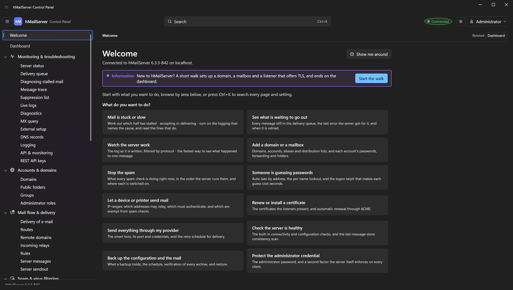
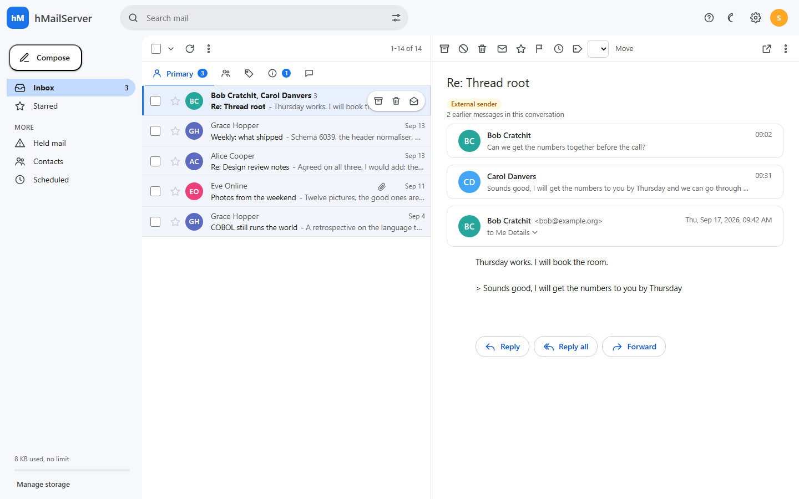
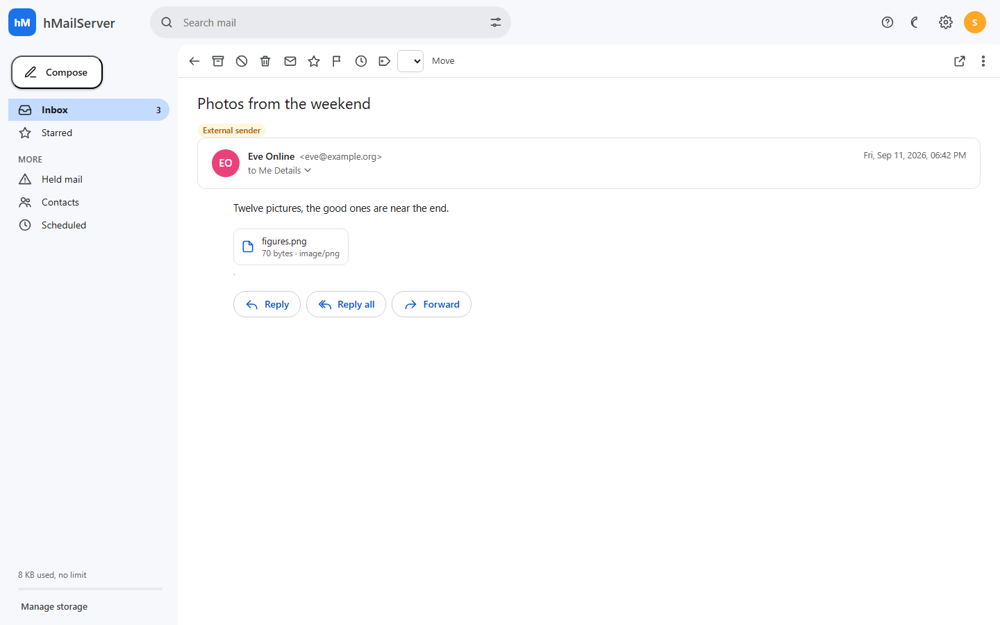

hMailServer
===========

[](https://www.bestpractices.dev/projects/14949) [](https://gitlab.com/hmailserver/hmailserver/-/releases/permalink/latest)

**The project's home is [GitLab](https://gitlab.com/hmailserver/hmailserver) since 22 September 2026.** GitHub has been unavailable to the project since 18 September 2026, so links to github.com/Progressiverobot answer 404; the issues, merge requests and wiki are on GitLab, and every release up to 6.3.3 is re-published there under its original date, with its files byte for byte, but for 6.2.0 and 6.0.0-B4, whose files were not preserved.

hMailServer is a free, open source email server for Microsoft Windows, implementing SMTP, IMAP and POP3. Since 8 September 2026 the server itself also builds, runs and packages on Linux, for x86-64 and AArch64 - see [Linux and AArch64](#linux-and-aarch64) below for exactly how far that goes.

This repository is a maintained fork of the original project, which is no longer developed upstream. It has been brought up to date with a current toolchain, current cryptography, and the transport-security and authentication standards expected of a mail server in 2026 — while remaining a drop-in upgrade for existing hMailServer installations. It is maintained by Christopher Holloway / [Progressive Robot Ltd](https://www.progressiverobot.com).

**[Download the latest release](https://gitlab.com/hmailserver/hmailserver/-/releases/permalink/latest)** — a single `hMailServer-x.y.z-x64.exe` installer for Windows, and a `.deb` and an `.rpm` for x86-64 Linux. The AArch64 packages and the AppImages were last published with [6.3.3](https://gitlab.com/hmailserver/hmailserver/-/releases/v6.3.3): 6.3.4 is the first release built off GitHub, and the project has no ARM machine to build them on. Upgrading in place preserves your configuration and mail; the database upgrade chain is continuous from every earlier hMailServer version.

Every release is validated by the full regression suite before it ships — the complete suite, run against the exact binary being released, with live SpamAssassin and ClamAV (real EICAR detection), SPF, DKIM and DMARC evaluated through the resolver code path against the suite's own DNS zone (one fake resolver the server is pointed at for the whole run, so no result depends on the Internet), and TLS 1.2/1.3 handshakes end to end. Nothing is skipped, and nothing but DNS is mocked. Before that run, the same suite runs once more on a build that keeps every internal assertion and reports a violated one to the ERROR log (`build\build.ps1 -Configuration Release -Asserts`), so the invariants the shipped binary compiles out are still exercised by every test.

**What changed in each version** is on the [Releases page](https://gitlab.com/Progressiverobot/hmailserver/-/releases). What is planned next, and what is deliberately not, is in [Roadmap.md](Roadmap.md). [Roadmap3.md](Roadmap3.md) maps what it takes to bring back on GitLab everything a user could download from GitHub - the AArch64 packages, the AppImages, the container image - and to add the ARM64 installer, the apt and dnf repositories, winget, Chocolatey and every other channel people install mail servers from. The release process itself is documented in [RELEASE.md](RELEASE.md), and the codebase map is in [ARCHITECTURE.md](ARCHITECTURE.md).

Where things are
----------------

* **Issues**: <https://gitlab.com/hmailserver/hmailserver/-/issues>, with a template for a bug, a feature and a question. A question is an issue with the `question` label; GitLab has no Discussions.
* **Board**: <https://gitlab.com/hmailserver/hmailserver/-/boards>, the issue board.
* **Wiki**: <https://gitlab.com/hmailserver/hmailserver/-/wikis/home>, the operator guides and the reference pages.
* **Releases**: <https://gitlab.com/hmailserver/hmailserver/-/releases>; the latest is always at <https://gitlab.com/hmailserver/hmailserver/-/releases/permalink/latest>. GitLab picks that release by date and has no pre-release flag. The stable download links always lead to the newest stable release, never a pre-release: `https://updates.progressiverobot.com/download/hMailServer-x64.exe`, `/download/hmailserver_amd64.deb`, `/download/hmailserver.x86_64.rpm`, and `/download/` for the release's page ([the full list](hmailserver/docs/UpdateFeed.md#the-download-links)).
* **Following releases**: the feed <https://gitlab.com/hmailserver/hmailserver/-/releases.atom> in any feed reader, or, signed in to GitLab, the bell on the project page set to **Custom** with **New release** ticked, for an email each time.
* **Forum**: <https://www.hmailserver.co.uk/>, where this fork's releases are announced and questions about running it are answered.
* **Service Desk**: an email address for anyone without a GitLab account, which GitLab files as a confidential issue; the address is under [Getting help](#getting-help).
* **Security**: [SECURITY.md](SECURITY.md). A vulnerability goes to a confidential issue or the Service Desk address, never a public issue.
* **Contributing**: [CONTRIBUTING.md](CONTRIBUTING.md), and [SUPPORT.md](SUPPORT.md) for what makes a report useful.

Contents
--------

* [Capabilities](#capabilities) — what the server does
* [Technology](#technology) — what it is built on
* [Administration](#administration) — the Control Panel and the APIs
* [Installing](#installing) — supported platforms, unattended install and the update check
* [Building hMailServer](#building-hmailserver)
* [Configuration reference](#configuration-reference)
* [Operator documentation](#operator-documentation) — the runbooks

Capabilities
============

Mail protocols
--------------

* **SMTP** with PIPELINING, ENHANCEDSTATUSCODES, 8BITMIME, SIZE, CHUNKING/BDAT (RFC 3030), DSN delivery status notifications (RFC 3461/3464) and SMTPUTF8/EAI for internationalised addresses.
* **IMAP4rev1**, plus **IMAP4rev2** (RFC 9051) advertised with its behavioural deltas implemented, including the extensions rev2 folds in (LIST-STATUS, non-synchronising literals, BINARY) — with IDLE, MOVE (RFC 6851), UIDPLUS (RFC 4315), CONDSTORE/QRESYNC (RFC 7162), SEARCHRES (RFC 5182), ESEARCH (RFC 4731), SORT and THREAD (RFC 5256, both ORDEREDSUBJECT and REFERENCES), ACL, NAMESPACE, ID (RFC 2971), SPECIAL-USE (RFC 6154, including explicit designation via `CREATE ... (USE (\Sent))`) and QUOTA. **COMPRESS=DEFLATE** (RFC 4978) compresses both directions of a session on request once the client has signed in, with the response that announces it the last plain line and every response flushed as it is sent, so a mobile client on a slow link pays for headers and bodies once at a fraction of the bytes; `IMAPCompressionEnabled=0` withdraws it.
* **POP3**, including retrieval from external POP3 accounts on a schedule - and from external **IMAP** accounts (`ServerType` 1: the INBOX, collected once by UID and left on the server unless told otherwise; with `MirrorFolders` on, every folder, byte for byte with flags and dates - a migration, see [Migration.md](hmailserver/docs/Migration.md)).
* **Migration jobs**: five hundred mailboxes at once from another IMAP server, Google Workspace or Microsoft 365 - a job per mailbox with a state, throttled per migration and per source host, resumed after a failure or a restart from marks written every fifty messages without copying anything twice, a report per mailbox, and the contacts and calendars beside the mail - and Outlook data files (PST), read by the server's own reader, written from Microsoft's published specifications, from a per-domain import directory: a job per file, throttled per migration, resumed from marks written after every message, the mail only, contacts and calendars counted in the report (`/api/v1/migrations`, and the Control Deck's Migrations view; see [Migration.md](hmailserver/docs/Migration.md)).
* **Public folders**, shared across accounts with per-user ACLs.
* **Shared and delegated mailboxes**: an account opens one of its own folders to another account with its client's SETACL (RFC 4314), and the folder appears to that account under the "Other Users" namespace of NAMESPACE and LIST (RFC 2342, `#Users.owner@domain.folder`), which is where an IMAP client that lists the Other Users namespace shows a delegated mailbox (a folder pane that shows only subscribed folders shows the ones the owner subscribed to; not measured here in Thunderbird or Outlook); without the lookup right the folder is absent from LIST and indistinguishable from one that does not exist. The same delegations are announced where Exchange announces them - as `AlternativeMailbox` elements of the Outlook Autodiscover answer - to a request that signed in over HTTPS as the account they were granted to, and to nobody else; see [Administration](#administration) for what that element is and is not.
* **CardDAV** (RFC 6352): each account's address books - the ones the webmail keeps, contact groups included, and the books other people share with it - served to phones and desktop clients from the web services listener, found by RFC 6764 discovery. See [Administration](#administration).
* **CalDAV** (RFC 4791): each account's calendars of events and tasks - several, with colours, shared with other accounts or with a group read-only or read-write, or with a delegate who answers invitations on the owner's behalf - served beside the address book from the same listener and found the same way, with an iCalendar module that expands recurrence across time zones, and free-busy for everyone in the domain (the `free-busy-query` report, and a route the webmail draws an availability strip from). See [Administration](#administration).
* **A calendar and a task list in the webmail** — month, week, day and agenda views over the same calendars a phone syncs, events created by a click and moved or resized by drag, a recurrence editor, reminders, guests invited by mail; tasks ticked off in the page or on the phone; and invitations by mail (iMIP) with Accept, Maybe, Decline and a counter-proposal, the answer filed into the organiser's event on delivery ([Calendar.md](hmailserver/docs/Calendar.md)).
* **Rooms and equipment** ([RoomsAndEquipment.md](hmailserver/docs/RoomsAndEquipment.md)) — Exchange's resource mailboxes: an account whose kind is a room or a piece of equipment, which nobody signs into, answers the invitations it is sent, just after they are delivered, by its booking policy (who may book it, the booking window, the longest booking, working hours, conflicts, recurring meetings), files the booking and sends the organiser an iMIP REPLY from its own address with the reason - and believes an organiser only when the server recorded that they sent it; what it does not answer, its delegates answer from its calendar. It is in the directory with its capacity and in a CalDAV client's room finder (`calendar-user-type` ROOM).

Transport security
------------------

* **TLS 1.2 and 1.3** by default, on implicit-TLS and STARTTLS ports, with SNI, configurable cipher suites (separately for TLS ≤ 1.2 and TLS 1.3) and configurable key-exchange groups — **hybrid post-quantum key exchange** (X25519MLKEM768) is preferred by default, on every TLS context inbound and outbound.
* **MTA-STS** (RFC 8461) policy discovery and enforcement for outbound mail, and optional hosting of your own policy at `mta-sts.<domain>`.
* **DANE** (RFC 7672) with full in-process **DNSSEC validation** (RFC 4033–4035) — a bogus chain blocks delivery to that host rather than silently downgrading. The **MX RRset is validated too**, not just the TLSA record (RFC 7672 §2.2): DANE is applied only to a host the recipient domain provably published, so a forged MX answer cannot redirect delivery to a host whose own TLSA record then validates. **A missing DS is proved missing, not assumed** (RFC 4035 §5.2, RFC 5155 §8): a delegation counts as unsigned only when the parent's NSEC or NSEC3 says so, so stripping the DS from an answer makes the chain bogus rather than quietly unsigned.
* **Gateway encryption to partner domains** ([RemoteDomains.md](hmailserver/docs/RemoteDomains.md#gateway-encryption)): mail to a named partner domain encrypted at the server to the partner's own OpenPGP key (PGP/MIME) or certificate (S/MIME enveloped-data), whatever the sender's client did - one gateway key per domain, pasted by the administrator and judged when it is saved, the partner's copy only, DKIM-signed afresh, the Subject left readable; a message that cannot be encrypted is refused `5.7.10` with a notice to the sender, or sent unencrypted and logged if the policy says so. Off for every domain until a policy asks for it.
* **An organisation CA for S/MIME** ([SmimeAuthority.md](hmailserver/docs/SmimeAuthority.md)): a domain's own authority - a P-256 (or RSA-3072) root made in the Control Deck, constrained to the domain's own addresses, its key held under the platform's secret store and never the legacy scheme - certifies the keys its accounts make in the webmail, so S/MIME works inside the organisation without buying a certificate. The key pair is made in the browser and never sent; the authority signs a PKCS#10 request for the account's own address or an alias of its own domain, one year, and once the key is stored supersedes the address's previous certificate unless kept. A colleague's certificates are looked up by address when a message to them is to be encrypted; the root and a signed CRL are served over plain HTTP by the web services listener, named by the root's fingerprint; the webmail trusts the domain's roots by itself and reads the authority's record, so a revoked certificate is refused and no longer encrypted to; an account's deletion revokes its certificates; a rotation keeps the old root published and trusted until its last certificate expires; the authority is in the configuration backup. No key escrow, so nothing recovers mail encrypted to a lost key. Nothing is issued until an administrator creates a domain's authority.
* Encrypted (passphrase-protected) TLS private keys, with the passphrase held per certificate and protected at rest.
* TLS session-ticket key **rotation** (OpenSSL's default key is generated once per process and never rotated, so every ticket it issues is sealed under the same key), plus session cache and timeout control and the ability to disable tickets entirely. All off by default.
* An `AEAD-ONLY` cipher preset, which excludes every CBC construction and the Lucky13 family; nothing below TLS 1.2 can connect under it.
* DNSSEC validation also protects SPF, DKIM and DMARC record lookups.
* **TLS-RPT** (RFC 8460) daily aggregate reports to recipient domains — off until `TlsRptFromAddress` is set (the server notes this in the application log while statistics are collected unsent).
* **The reports our own domains receive, read**: name a report mailbox on a domain (`Domain.ReportMailbox`, `report_mailbox`), publish it as `rua=mailto:` in the domain's `_dmarc` and `_smtp._tls` records, and the DMARC aggregate reports (RFC 7489 and RFC 9990) and TLS-RPT reports (RFC 8460) that arrive there - gzip, zip or plain, XML or JSON - are parsed into `hm_dmarcreports`, `hm_dmarcreportrecords` and `hm_tlsreports`. The Control Deck's DMARC page charts who sends as the domain and with what result, per source and per day, the way the paid DMARC services do; `hmctl dmarc` and `GET /api/v1/domains/{domain}/dmarc-reports/summary` answer the same numbers. Only the named mailbox is an intake, a report about a domain that names none is not recorded, and nothing read here acts on any mail ([DmarcReports.md](hmailserver/docs/DmarcReports.md)).
* **ACME v2 (Let's Encrypt)** built in: certificates are issued, renewed, assigned to TLS ports and hot-reloaded without a restart. The private key is reused across renewals, so published DANE TLSA records stay valid.

Sender authentication and anti-abuse
------------------------------------

* **SPF** (RFC 7208 - all seven results, and the openspf.org conformance suite for it, 203 cases, run on every build of both platforms), **DKIM** signing and verification (including Ed25519, RFC 8463) and **DMARC** evaluation with alignment, with the organizational domain resolved from the real **Public Suffix List** (compiled in, wildcard and exception rules, ICANN and private sections) rather than a heuristic. SPF resolves through the same resolver as everything else here, so it honours `DNSServer`, the DNS cache setting and DNSSEC validation, and it works on Linux.
* **DKIM signature timestamps**: every signature carries `t=`; an `x=` expiry is added when `DKIMSignatureValiditySeconds` is set, and expired signatures are refused on verification (on by default, with a configurable clock-skew allowance). Optional **oversigning** (`DkimOversignHeaders`, off by default) stops a second `From:` being prepended to signed mail.
* **ARC** sealing (RFC 8617) so forwarded mail keeps a verifiable authentication chain — off by default (`ArcSealingEnabled`). Inbound ARC results can also recover the original authentication result so forwarding stops costing legitimate mail its DMARC pass — off until both `ASArcFilteringEnabled` and a list of trusted sealer domains are set, because anyone can seal a chain with their own key and a passing chain proves nothing on its own.
* Optional **SRS** sender rewriting for forwarded mail (`SRSEnabled`, off by default), and optional **BATV** (`prvs`) backscatter protection.
* **SpamAssassin** integration, **DNSBL** and **SURBL** lookups (each server with an expected result, so a resolver's refusal code is never a listing), greylisting - keyed by a digest of each address so two long addresses are two triplets, with an optional sliding wait and a `550` for a sender that retries too soon too often, and a bypass list that lets a named domain past it only on an SPF, DKIM or DMARC pass ([docs/Greylisting.md](hmailserver/docs/Greylisting.md)) - HELO/PTR/MX sanity checks and a weighted scoring pipeline.
* **SMTP policy the score cannot express**, all off by default: SPF's SoftFail, TempError and PermError each scored on their own, with TempError optionally answered `451` so a resolver blip defers rather than refuses; `MAIL FROM:<>` naming more than one recipient refused (a delivery report has one), with an optional ban through the same auto-ban; and a **domain white and black list** keyed by envelope domain or HELO suffix rather than by IP address - black a `550` at `MAIL FROM` before anything runs, white past greylisting and the score's refusals while every test still runs and logs. See [docs/SmtpPolicy.md](hmailserver/docs/SmtpPolicy.md).
* **Virus scanning** via ClamAV (clamd or clamscan) or any command-line scanner. The Control Panel's ClamAV test asks the daemon `PING` and `VERSION` before it scans, names the daemon it reached, and streams its EICAR sample from memory so the host's own antivirus cannot remove it first.
* **Attachments opened in a sandbox** ([Sandbox.md](hmailserver/docs/Sandbox.md)): a message that none of your own signed-in users submitted, whose attachment is an executable, a script, an archive or an office document, is held - in no mailbox and not in the quarantine - while a sandbox you run or subscribe to opens the file, and the answer decides: clean is delivered with an `X-hMailServer-Sandbox` header, malicious is quarantined (returned to its sender while the quarantine is off; the release of what the sandbox quarantined does not submit it again), and an error on a file once every file has answered, or `SandboxTimeoutMinutes` without an answer, delivers with a header or returns it to its sender, as `SandboxTimeoutAction` says. What your own users send is not uploaded to the third party unless `SandboxInternalMail` asks for it. The sandbox is any HTTP service answering a two-route contract - no vendor adapter is shipped - and verdicts are remembered by SHA-256. Off until an administrator names one, and refused on until both addresses are set; the held messages on `GET /api/v1/sandbox/held` and the Deck's queue page, with release and discard on the audit trail.
* Attachment blocking, IP ranges with per-range policy, and connection auto-banning after repeated authentication failures.
* **Compromised-account detection**: an authenticated account that starts sending in the shape of a takeover - a surge past its own baseline, mostly to addresses it has never written to, at an hour or from a network it has never used - is caught at submission. Watch by default (the baseline is built and `account.compromised` says what enforcing would have done); in enforce mode the message is kept out of the delivery queue for review, the account's other queued mail with it, the account is locked until an administrator unlocks it, and the alert and the `account.locked` webhook are raised. Reviewed on the Deck's **Held for review** page and under `/api/v1/review`; per account, exempt and sensitivity ([CompromisedAccounts.md](hmailserver/docs/CompromisedAccounts.md)).
* **Account recovery**: a person sets a recovery address and ten one-time codes in the webmail's Security page, and uses them instead of raising a ticket. The address counts for nothing until a link sent to it is followed, and only its masked form is ever shown again - to the account holder, to an administrator, over REST, anywhere. A code stands in for a one-time code from an authenticator app wherever one is asked for - at sign-in, at a password change, when minting an app password and on the recovery card itself - each good once, and the webmail offers a field for one beside the authenticator's at every one of them. *Forgotten your password?* on the sign-in card sends a single-use half-hour link to the confirmed recovery address and nowhere else, answers the same sentence for every address so that it is no address directory, and on completion applies the same password policy, reuse history and breach check as the webmail's own form, ends every browser session of the account, tells the mailbox and the recovery address, and raises `account.password-reset`. An administrator can see whether an address is set and confirmed, and can clear the address or end the code set; nobody can read either ([AccountRecovery.md](hmailserver/docs/AccountRecovery.md)).
* **Login and recipient tarpitting**, both off by default and both a pause on the connection's own timer rather than a thread asleep: a failed logon's refusal is delayed progressively (`LogonTarpitSeconds`, on SMTP/POP3/IMAP), and recipients past a count in an unauthenticated SMTP session are held (`SmtpTarpitCount` / `SmtpTarpitDelaySeconds`).

Account security and authentication
-----------------------------------

* **SCRAM-SHA-256** SASL across IMAP, SMTP submission and POP3, plus **SCRAM-SHA-256-PLUS** channel binding on all three, with deterministic anti-enumeration salts. SMTP and POP3 offer SCRAM whenever AUTH is available; on IMAP, SASL (PLAIN and SCRAM alike) sits behind one setting whose shipped default is off.
* **OAuth2 / OpenID Connect** bearer tokens — SASL XOAUTH2 and OAUTHBEARER (RFC 7628) — validated against an external identity provider's signing key: from the provider's published JWK Set (RFC 7517, so a key rotation needs no hand-copied file; `OAuth2JwksUrl`) or a PEM file, with optional token introspection (RFC 7662; `OAuth2IntrospectionUrl`) so a revoked token stops working before it expires.
* **Message retention** per domain and per account (`MessageRetentionDays`; the account's value overrides the domain's, -1 keeps forever): delivered mail older than the policy is removed by a six-hourly sweep through the same path an EXPUNGE takes, so quotas, QRESYNC records and open IMAP sessions all see it. Off everywhere until a number is set; `Utilities.RunMessageRetention` runs the sweep on demand. Beside the administrator's policy, each account holder has three choices of their own on the webmail's preferences page - empty Trash after, empty Junk after, archive Inbox mail after (never, 7, 30, 90 days or a year), kept with the account as `retention_trash_days`, `retention_junk_days` and `retention_archive_days` - which the same sweep runs: Trash and Junk are emptied of what is older than the choice, and Inbox mail older than the choice is moved to the Archive folder, made if there is none.
* **Message recall within the server** ([MessageRecall.md](hmailserver/docs/MessageRecall.md)): an unread message sent to accounts on this server can be withdrawn by its sender - Outlook's recall within Exchange, kept within this server. **Recall** on a Sent message in the webmail, `POST /api/v1/me/recall` for a program: the unread copies are deleted the way the webmail deletes a message, the read ones stay with their readers, a recipient elsewhere is counted and never reached, and no notice goes to anybody. Recorded only for a message submitted over authenticated SMTP or from the webmail, under the account that signed in; `RecallDays` (14) bounds it.
* **Restricted delivery** ([RestrictedDelivery.md](hmailserver/docs/RestrictedDelivery.md)): accounts, or a whole domain, that may only exchange mail with named domains - Google Workspace's restrict delivery, for a school or a regulated desk. The domain names the domains (`Domain.RestrictedDomains`, `restricted_domains`: `partner.example`, or `.example` for the domain and everything beneath it, the domain policy list's own spelling), each account follows it or is restricted or exempt (`Account.RestrictedDelivery`, `restricted_delivery`), and the one decision is enforced at `RCPT TO` in both directions with a `550 5.7.1` per recipient, at delivery for a list member or an alias target, and on the account's forwards and out-of-office replies. Bounces, the postmaster and the own domain's aliases always get through; other hosted domains must be named.
* **Journaling and dual delivery** ([Journaling.md](hmailserver/docs/Journaling.md)): a copy of a domain's mail, or of one account's, sent to an address - as the Exchange envelope report, whose text carries the envelope sender, the subject, the Message-Id and one line per envelope recipient with the original attached `message/rfc822` byte for byte, or, Google's dual delivery, as the message itself with one header added and nothing else changed. Per rule: a domain or one account, mail arriving, mail sent over an authenticated session or both, and where the copy goes - local or anywhere else, delivered through the ordinary queue. Evaluated once per accepted message where the recipients are known - in the SMTP session and in a fetch account's download alike, so mail a mailbox collects from another provider is archived too - and so a retry never makes a second copy; one copy per matching rule rather than per recipient. It does not loop: a journal message carries `X-hMailServer-Journal`, whose value is the rule's id and a mark the server process chose at random, and a message carrying that mark is never journalled again - while a header a sender wrote decides nothing, because an archive the people it is about can opt out of with one line in their mail client is not an archive. Off unless a rule exists, and it is not the archive, not a forward and not retention: it sends mail elsewhere and keeps nothing.
* **eDiscovery** ([Discovery.md](hmailserver/docs/Discovery.md)) — cases, searches, holds and exports, as Google Vault and Microsoft Purview have them: a search across the custodians' mailboxes, their deleted items and the archive by person, date, words and attachment (name, type and size), matching what IMAP SEARCH TEXT reads and reading every message whole up to 80 MB, listing what it could not read rather than dropping it; a legal hold on an account, a domain or the archived copies a search matched that every deletion of a message in the held mailbox honours - the person's expunge and a move out of the account, the account's own rule Delete, Sieve discard, forward and spam delete threshold, retention, the recover-deleted sweep, a restore's replace, a full restore, a move to another domain and the account's and domain's deletion keep the mail or are refused - and that does not reach the server's or a domain's rules, spam and virus deletion before a message is the account's, or the queue; and an export of the hits as EML byte for byte, an mbox per folder and a manifest with every file's SHA-256, downloadable under `view_discovery` and `view_mailbox`, and `view_archive` for the archive's copies. Every search is on the audit trail with its query while the trail is on, and in the case's own record whatever it says. Not PST: an examiner converts the EML with a third-party converter.
* **Inbound webhooks** ([InboundWebhooks.md](hmailserver/docs/InboundWebhooks.md)) — mail in, to a webhook, as SendGrid's and Mailgun's inbound parse: an address or a whole domain whose mail is posted to a URL, parsed - sender, recipients, subject, text, HTML, attachments and the verdicts - as SendGrid's multipart/form-data fields or one JSON document, with the raw message on request, signed and retried as an outbound webhook is. Per route, whether the mailbox gets the message too, whether a message the endpoint never accepted is kept for the administrator or returned to its sender, a size ceiling and an attachment policy. An endpoint may be on the administrator's own network but never a link-local or cloud metadata address; a route an API key makes reaches public addresses only. Made over `/api/v1/inbound-webhooks` and on the Control Deck, by a credential holding `manage_inbound_webhooks` in the route's domain.
* **SASL EXTERNAL** (RFC 4422) on SMTP, IMAP and POP3: a client certificate that verified against the port's CA logs on as the mailbox the certificate names (a subjectAltName rfc822Name, the subject's emailAddress, or an address-shaped CN). Offered only on a connection that presented such a certificate; a certificate for one user is never a credential for another.
* **LDAP directory authentication** against Active Directory or any LDAP directory, so accounts authenticate with their domain password. Simple bind and SASL Negotiate; LDAPS and StartTLS; certificate validation on by default, and a password is never sent over an unprotected connection unless that is explicitly permitted. Unlike the Windows-logon path it needs no domain-joined host, which is the usual situation for a mail server in a DMZ. Infrastructure failures are reported separately from wrong passwords, so a directory outage does not read as a hundred users mistyping. Off by default: the whole `[LDAP]` ini section is absent until you add it.
* **LDAP directory provisioning** — the directory as an account source, not only as a password check. Preview reports exactly which mailboxes the directory says should exist and changes nothing; apply then creates and updates them. The two share one decider, so a preview cannot describe an action the apply would not take. A domain takes part only if its Active Directory domain name is set, which makes provisioning opt-in per domain and keeps a search base pointed one level too high from provisioning into unrelated hosted domains. Nothing is ever deleted: the most it does is mark an account inactive, and only when asked — never on a truncated or empty enumeration, and never for a domain in which nothing was seen. An optional unattended schedule (`[LDAP] SyncScheduleMinutes`, off by default) creates and updates but never disables. Verified end to end against a live Windows Server 2025 domain controller.
* **SCIM 2.0 provisioning** — the other direction: the organisation's identity provider (Entra ID, Okta) calls this server at `/scim/v2` on the REST listener and makes, renames, suspends and removes accounts, with their aliases, and distribution lists, as people join, move and leave. Only an API key answers there - one whose role holds the `provision` permission, as a full-scope key's does and a custom role can on its own - confinable to named domains, and never over an account that reaches further than it does; a rename is the mailbox move, keeping the old address as an alias; a suspension or a new password ends the account's sessions and drops its connections; a change is judged whole before any of it is written; every write is on the audit trail under the key. The LDAP backend authenticates; SCIM provisions ([hmailserver/docs/Scim.md](hmailserver/docs/Scim.md)).
* **Argon2id**, **scrypt** (RFC 7914) and **PBKDF2-HMAC-SHA256** password hashing, with tunable work factors, transparent upgrade on login (of the scheme, and of a hash cheaper than the configured work factor), a minimum-accepted-hash policy, and an optional server-side pepper.
* **Secrets at rest** ([SecretsAtRest.md](hmailserver/docs/SecretsAtRest.md)): an account's TOTP second factor, `SRSSecret`, `BATVSecret`, `OAuth2HmacSecret`, the metrics listener's credentials and every other `[Settings]` key that holds a secret are sealed in the database (and in `hMailServer.ini`'s copy) under the installation's stored-secrets key - AES-256-GCM, the second factor bound to its account. The key is made by an elevated step only - the Windows installer on a new installation, `--create-stored-secrets-key`, the Linux `--create-database` - never by a service's start, and its id is recorded in the database, which refuses a second key and checks every import, so a warm standby given it with `--export-stored-secrets-key` and `--import-stored-secrets-key` opens them as the primary does. An upgrade makes no key: sealing stays off, as before, until an administrator makes one, and the setup checklist asks for it and for an export, which is what a database-level backup needs beside it; lost for good - no node and no export holds it - `--forget-sealed-secrets KEYID` clears what was sealed under that key alone. A backup archive carries them opened, so a restore seals them again wherever it runs. The administrator password is PBKDF2: the Windows installer has the server write it (`hMailServer.exe --set-admin-password`, the password never on a command line), and an older MD5 or SHA-256 value is written again as PBKDF2 at its next sign-in. On a packaged Linux server, whose configuration is root's, the key is made with `sudo hmailserver --create-stored-secrets-key`, the file's `[Settings]` lines stay as written until `sudo hmailserver --set-setting` rewrites them, and the re-hash waits for `sudo hmailserver --set-admin-password`.
* Full RFC 4013 SASLprep of non-ASCII credentials on the PLAIN and LOGIN paths (SCRAM usernames are matched as sent).
* **TOTP two-factor authentication on the administrator credential, enforced by the server** on every surface: the COM API refuses the password alone and `AuthenticateWithCode` is the way in, and the REST API takes the code in an `X-hMailServer-OTP` header. Enrol and remove it from the Control Panel or over COM; the secret is stored machine-protected in `hMailServer.ini`.

Mail filtering and routing
--------------------------

* **Sieve** (RFC 5228) — a standards-based interpreter runs each account's active script during delivery (`keep`, `fileinto`, `discard`, `redirect`, implicit keep, plus the `copy`, `relational`, `subaddress`, `imap4flags` and `vacation` extensions), with an optional **ManageSieve** (RFC 5804) listener so clients can manage scripts over TCP.
* **Mail flow rules** — rules for one domain beside the server's and an account's, a condition on the attachment name, and the four actions a transport rule has: add a disclaimer, reject with a text before the message is accepted, require TLS for the delivery, quarantine ([MailFlowRules.md](hmailserver/docs/MailFlowRules.md)).
* **Impersonation protection** ([ImpersonationProtection.md](hmailserver/docs/ImpersonationProtection.md)): Microsoft 365's anti-phishing policies, per domain and off by default. On mail from outside - the external-sender tagger's own decision, shared - a display name that is an active account's person name or a protected person's while the address is not theirs, and a sender domain one edit or one look-alike character (`rn` for `m`, `1` for `l`, a Cyrillic `а`, an IDNA spelling) from a domain this server hosts or a protected partner, are flagged with `X-hMailServer-Impersonation`, which the webmail turns into a warning bar, or held in the quarantine as a spam verdict would be; a sender the reader marked safe is exempt.
* **Outbound shaping** — a destination that answers a slow-down reply (a `421`, a rate-limit code, or words to that effect) gets a back-off window in which nothing is sent to it and to nobody else, one delivery probes it when the window ends and the same answer doubles it; a connection ceiling for destinations no remote domain policy names, and a per-tenant share so one hosted domain - or all relayed mail together - cannot hold every delivery thread; a deferral this server chose does not spend a message's retries until the message has been queued longer than its retry schedule spans; the windows and counts on `GET /api/v1/queue/shaping` and the Deck's queue page, one cleared with a `DELETE` ([OutboundShaping.md](hmailserver/docs/OutboundShaping.md)).
* **IP warm-up** ([IpWarmup.md](hmailserver/docs/IpWarmup.md)): a schedule for a new outbound address - the address `SMTPDeliveryBindToIP` or a rule binds - holds it to a daily ceiling of recipients per large provider (Google, Microsoft, Yahoo, Apple, Proton, decided from the mail hosts rather than the recipient's domain; every other provider at five times the ceiling), rising along one of three fixed plans (standard over thirty days, gentle over sixty, fast over fifteen). The queue reserves a batch's recipients before it connects and counts what was delivered, and holds what is over the ceiling - until the next UTC day once the day's ceiling is reached, a few minutes while deliveries in progress hold the room - without spending a retry unless the message's retry schedule says the try is counted (a remote failure in the same pass, or a message queued longer than its retry span, whose counted tries then land on following days). `GET/POST /api/v1/warmup`, `PUT`/`DELETE /api/v1/warmup/{id}` and `/history`; the counts and a small editor are in the Deck's queue page; the schedules are in the configuration backup. Nothing is held until a schedule is made.
* **Outbound content policy** — rules on what leaves: a card number (Luhn) or an IBAN (the registry's lengths and check digits) in the text or a text attachment, an account number by a pattern of your own, an attachment typed by its bytes rather than its name, an outside recipient on a message marked internal; refused at DATA naming the rule, quarantined for review, or let go with a notice to the sender ([OutboundContentPolicy.md](hmailserver/docs/OutboundContentPolicy.md)).
* **The organisation's directory** — every active account and enabled distribution list of a domain, findable by the people of that domain and no other: a title, a department, telephone numbers and a photo that an administrator or the person themselves sets, an opt-out that is the person's whatever the server says, the webmail's Directory page and its To, Cc and Bcc completion (the reader's own contacts first, then the directory), and a read-only Directory address book beside the reader's own over CardDAV so a phone sees it too ([Directory.md](hmailserver/docs/Directory.md)).
* **Shared address books** — an account keeps several address books, and shares one with a colleague or with every account of their own domain, read-only or writable: the sharee sees it as a second book in the webmail's Contacts page, is offered its people in To, Cc and Bcc labelled with whose book they came from, and syncs it on a phone as another CardDAV collection ([SharedAddressBooks.md](hmailserver/docs/SharedAddressBooks.md)).
* **A person's data, exported and erased** — everything the server holds on an account as one .zip (mail as mbox per folder, contacts as vCard, calendars, preferences, filters, the log lines naming the address and the backup's account.xml), downloaded by the person from their own Settings page or by the operator, and an erasure that reaches other people's address books, the first-contact memory and, asked by name, the log files, while a held archive copy keeps its file ([PersonalData.md](hmailserver/docs/PersonalData.md)).
* **A quota policy, not a quota** — three points around a mailbox's limit: where the owner is warned and in what words, how far past the limit incoming mail is still accepted, and where the account stops sending before it stops receiving; each per domain or server-wide, and a report of who is nearest their limit ([QuotaPolicy.md](hmailserver/docs/QuotaPolicy.md)).
* **Out-of-office as a policy** — an account's reply and a domain's, with a text for colleagues that never leaves the server and a general one for everybody else, a reply for colleagues only, the domain's text in place of an account's for strangers when the domain says so, and a window in days after which the same sender is answered again (0 is once per absence), remembered in the database rather than in the process so a restart repeats nothing; RFC 3834 decides what is never answered. `hmailserver/docs/OutOfOffice.md`.
* The original rules engine, with global and per-account rules, regular-expression criteria and scripted actions.
* Server-side **event scripts** on connection, HELO, DATA, accept and delivery events - VBScript and JScript on Windows, with `ScriptAllowedObjects` bounding which COM classes a script may create, and JavaScript on Linux, in the QuickJS engine the server embeds, with a timeout, a memory ceiling and no file, network or process access ([EventScripts.md](hmailserver/docs/EventScripts.md)).
* Routes, aliases, distribution lists, catch-all addresses and plus-addressing.
* **A distribution list that defines itself** — a list whose members are a query rather than a table somebody maintains: every active account of a domain, of a named domain, of an address pattern, or of the whole server, evaluated at the moment a message is sent to it and joined with the addresses the list keeps by hand. Moderation, the sender rules and the bounce address are unchanged by it ([DistributionLists.md](hmailserver/docs/DistributionLists.md)).
* **Mailing lists** — a distribution list with the list manager switched on is what a small organisation runs Mailman for: people join by mail or by page, confirmed and - where the list says so - approved by its owner, and leave the same way or with RFC 8058's one-click unsubscribe - offered over an https base URL, on copies the list signs with its domain's DKIM key when that domain signs, which is what Gmail and Yahoo ask before they show it; every member is sent a copy of their own carrying the RFC 2369 fields and their own way out, or one digest a day, or nothing for now; the list adds its subject prefix once, its Reply-To and its footer, keeps an archive by month on a page of its own, and counts its members' bounces - VERP, a hard bounce or five soft ones pausing the address and telling the owner, and a forged report counting for nothing. It does not rewrite `From` for DMARC ([MailingLists.md](hmailserver/docs/MailingLists.md)).
* Multiple smart hosts with automatic failover: separate several hosts with `|` in the relayer field and delivery moves to the next when one cannot be reached.

Operations and observability
----------------------------

* **Prometheus** `/metrics` (database pool, TLS handshakes, delivery queue, authentication outcomes, delivery outcomes, command and query latency) with Kubernetes-style `/livez`, `/readyz` and `/healthz` probes.
* **Metric history**: one sample per metric per minute kept in the database (`MetricsHistoryDays`, a week by default), read back averaged per minute, ten minutes or hour by the Control Panel dashboard's 24 h / 7 d / 30 d views, by `GET /api/v1/metrics/history?metric=…&range=24h|7d|30d` and by `Utilities.GetMetricHistory` over COM. Two of the samples are not in-memory counters but an aggregate over the message store — `store_bytes` and `store_messages`, which are what makes storage growth answerable at all; they are recomputed at most once an hour and the same cached figure is what `/metrics` and the sampler both serve, so neither a scrape nor a sample puts a full-table aggregate on the clock.

* **Reports** — what happened on this server, per domain and per day, at `GET /api/v1/reports`: messages in and out, delivery failures by SMTP status code with the reason in words, the top senders and recipients, the largest mailboxes and the per-domain roll-up, the server-wide volume (processed, delivered, deferred, bounced, spam, viruses) and the storage growth. Seven sections and a `summary`, each for a window (`from`, `to`, 366 days at most), optionally one domain, and each answerable as `text/csv` with `format=csv`. The Control Deck has a page for them and `hmctl report` fetches them from a shell. **A report is only as true as what was kept, and this one says so:** the first four sections are counted from the message trace, which is off by default (`MessageTraceEnabled`) and records only deliveries and failures; the mailbox sizes are what the store holds *now*, not a history; and the spam, virus and storage figures are server-wide counters with no domain in them, so they are not offered per domain and a domain-restricted key is refused them outright. The index names every one of those limits. [Reports.md](hmailserver/docs/Reports.md) is the walk.
* **Follow one connection live** — the Control Deck's Logs page lists every connection the server has open now (the SMTP, POP3 and IMAP sessions it answers, and the ones it opens itself) and the last ones that ended, each with the id its log lines carry, and *Follow* shows every line the server logs for one as it is written — what a grep through the day's log for a session id stood in for. Behind it are `GET /api/v1/logs/sessions` and `GET /api/v1/logs/sessions/{id}?after=<cursor>&wait=<seconds>`, under the log's own permission: the server keeps the last 4,096 log entries in memory for it, a follow is a cursor the server holds until the next line lands (the listener cannot stream a response), and nothing survives a restart. [FollowConnection.md](hmailserver/docs/FollowConnection.md) is the walk.
* **OpenTelemetry** export over OTLP/HTTP for all three signals - traces (`/v1/traces`), metrics (`/v1/metrics`) and logs (`/v1/logs`) - each with its own endpoint setting and each off until it is set. The exported metrics are the same counters the Prometheus `/metrics` endpoint serves, under the same names, rather than a second tally. Inbound W3C `traceparent` is honoured on HTTP and on SMTP (where it travels as a message header), and emitted onward, so a message keeps one trace across hops. Plus message-to-session correlation IDs.
* **SNMP** ([Snmp.md](hmailserver/docs/Snmp.md)): a read-only agent, off by default, answering the mail MIB (RFC 2789) and the standard groups from the same counters `/metrics` serves - SNMPv3 at authPriv only (HMAC-SHA-256, AES-128), SNMPv2c only when asked for, and nobody at all until a manager's address is in its allow list. Get, GetNext and GetBulk; no Set and no traps.
* Optional **JSON-structured logs**, log retention, per-service log files, and a slow-query log with every SQL string literal redacted.
* An **update check** (`UpdateCheckEnabled=1`, off until you opt in): once a day the server reads the project's release feed and says in the application log, the Control Panel, `Status.UpdateState` and `GET /api/v1/update` when a newer release exists - the version, the date and the page. It sends nothing but the request, and the check itself downloads and installs nothing: fetching, verifying and applying the release are the separate, equally opt-in steps described under *Update check* below.
* Per-stage timing of message acceptance, so a slow scanner, DNS lookup or event script is identified by name in the log rather than appearing as an unexplained pause. Acceptance is also bounded: if it runs past its deadline the sender gets a temporary `451` and retries, instead of waiting for a reply that never comes. Every wait that can hold a pooled thread - scanners, DNS, event scripts, external processes, outbound sessions - has a ceiling, and the work queue reports which task is holding each thread when they are all busy. See [diagnosing slow or stalled mail](hmailserver/docs/DiagnosingStalledMail.md).
* **A compressed message store, with large attachments held once** ([MessageStore.md](hmailserver/docs/MessageStore.md)): with `MessageStoreCompression` on, a message delivered to a mailbox, appended, collected by the IMAP mirror or brought in by a migration is stored deflated, and each MIME part of at least `MessageStoreDedupMinKB` (256 KB) is kept once however many messages carry it, counted by name so that the last one to go takes it with it. Only the server's own writer makes a container: bytes from outside that begin with the format's magic are wrapped, never taken for one. IMAP, POP3, the webmail, the sizes, the quota, search and a DKIM check see the message exactly as it arrived; the queue and the event scripts see plain RFC 822 as always. Off by default; `hmailserver --measure-store` says what it would save without changing anything, `--compress-store` rewrites the store in place (and `--decompress` puts every container back to plain RFC 822 byte for byte), and `GET /api/v1/store` and the Deck's dashboard say what it saves now.
* **Object storage for the message store** ([ObjectStorage.md](hmailserver/docs/ObjectStorage.md)): the mailboxes' messages, their parts held once and the kept deleted items in an S3-compatible store - AWS S3, MinIO, Wasabi, Backblaze B2's S3 API, Ceph RGW, signed with SigV4, path-style or virtual-hosted, multipart above 16 MB - or in Azure Blob Storage with Shared Key or a SAS, with the database as the index and the object named by the path its file had. TLS is always verified, against a CA file for a store behind the organisation's own CA. Every write is a local one - a delivery is placed on the disk and done - and a committer puts each message into the store afterwards and only then takes it off the disk, so a store that cannot be reached loses nothing and holds up no delivery: its messages wait on the disk and are read from there, IMAP answers `NO [UNAVAILABLE]` and POP3 `-ERR [SYS/TEMP]` for one only in the store, and no placeholder is ever written while a store is named. `hmailserver --copy-store-to-object-storage` copies the store, verified, going on where it stopped, and `--copy-store-from-object-storage` brings it back. Off until a store is named; REST's `/api/v1/settings` and the Control Deck.
* **Mailbox encryption at rest** ([EncryptionAtRest.md](hmailserver/docs/EncryptionAtRest.md)), Dovecot's mail-crypt shape: an administrator switches it on per account, and every message stored in the mailbox from then on is encrypted - compressed first - to an X25519 key of the account's own, one ephemeral key per file, so mail that arrives while nobody is signed in is encrypted all the same. The key's private half is wrapped by the account's password (Argon2id) and sealed to the domain's recovery key, whose passphrase the administrator keeps and this server never stores; until the first sign-in with the password it is held under the machine's own key, which on Linux is a file inside the data directory. A sign-in with the password opens it, it closes fifteen minutes after its owner's last use once no session holds it, and IMAP, POP3 and the webmail's account routes then accept only the account's own password - no app password, token, passkey or master user. Every writer into the mailbox encrypts, reading one decrypts in memory and writes no copy, and the full-text index holds none of an encrypted mailbox's words; search reads it while the key is open. It protects the disk, the backups and the database from being read, once the first sign-in has wrapped the key - not the mail from the running server, which is what a [zero-access mailbox](hmailserver/docs/ZeroAccess.md) is for, and the two are never on one mailbox. `hmailserver --encrypt-store` encrypts what was there before the switch, and `--decrypt-store` puts it back.
* Backup and restore — the whole server, or since 22 September 2026 **one mailbox or one message** out of an archive in the backup destination, merged into the live mailbox or replacing it, from the Deck, the Control Panel, COM, REST and `hmctl` ([Backup.md](hmailserver/docs/Backup.md)) — a read-only **message-store consistency check** with a recovery report, configurable message-store fsync, graceful-shutdown drain, and a documented active/passive HA runbook.

Technology
==========

| Component | Detail |
|---|---|
| Server core | C++, built with Visual Studio 2026 (platform toolset v145), 64-bit only |
| Cryptography | OpenSSL 4.0.x. Not an LTS branch: it leaves support on 14 May 2027, and the decision is recorded here rather than left for that month. OpenSSL's release policy puts an LTS in April of every odd-numbered year, so the next lands in April 2027; the plan is to move to it within a month of its release. If anything in the 4.x line has proved unstable by then, the fallback is a step back to 3.5 LTS (supported to 8 April 2030) |
| Async I/O | Boost 1.92 (Asio) |
| Databases | MySQL, MariaDB, MS SQL Server, PostgreSQL 18 (libpq), and the embedded SQL CE for zero-configuration installs |
| MySQL/MariaDB client | MariaDB Connector/C, shipped as `libmysql.dll` with auth plugins — works with MySQL 8 `caching_sha2_password` and MariaDB `ed25519`/`gssapi` out of the box. On Linux the packaged `libmariadb.so.3` is loaded instead, or Oracle's `libmysqlclient` where there is none, with the TLS options in each client's own numbers |
| Database transport | TLS to every backend from `[Database]` in `hMailServer.ini`: `TlsMode` - `prefer` by default, encrypted whenever the server offers it; `require`; `verify-full`, the server's certificate checked against `TlsCaFile` or the system's store; `disable` - and `hmailserver --check-database` to see what a connection gets before the service is given it ([DatabaseTls.md](hmailserver/docs/DatabaseTls.md)). PostgreSQL's own `PostgreSQLSslMode` and `PostgreSQLSslRootCert` still win when set, and SQL Server's `ConnectionStringOptions` is appended verbatim. Until 25 September 2026 the MySQL/MariaDB connection was never encrypted through MariaDB Connector/C, the client bundled on Windows and packaged on Ubuntu |
| Administration GUI and tools | C# / .NET 10 (WPF, Fluent design) |
| Extensibility | COM/IDispatch API, plus a REST administration API |
| Schema | Database version 6105, upgradeable from every earlier hMailServer release (`REQUIRED_DB_VERSION` in `Constants.h`; `build/check-schema-versions.ps1` fails when this row disagrees with it) |

**Quality gates.** Every release ships SPDX and CycloneDX SBOMs (Syft). On GitHub, until 18 September 2026, the repository ran CodeQL analysis, Dependabot CVE alerts with grouped update pull requests, a dependency-review gate on pull requests, an installer smoke test that installs the built installer on a clean machine and verifies the service comes up, and a monthly comparison against the original upstream repository so nothing landing there is missed. GitLab CI has replacements for three of them since 25 September 2026, not yet blocking: cppcheck, clang-tidy and Semgrep for CodeQL, Trivy with OSV for the dependency review and the alerts, and a check of the repository settings for OpenSSF Scorecard, on the project's own runner for `master`, `batch*` branches and release tags ([Security scanning](hmailserver/docs/ContinuousIntegration.md#security-scanning)). The installer smoke test runs on a throwaway VM, started from the maintainer's machine ([The installer smoke test](hmailserver/docs/ContinuousIntegration.md#the-installer-smoke-test)); Renovate is built to take over the update pull requests and waits for the owner's token and schedule ([Dependency updates](hmailserver/docs/ContinuousIntegration.md#dependency-updates)), and the upstream comparison does not run. GitLab CI runs the project's own checkers, the Deck's and the webmail's harnesses, editorconfig and the sign-off of every commit a merge request or a `batch*` branch adds on every push and merge request, and for `master`, `batch*` branches and release tags it builds the Linux server and its packages, runs the Linux suite and the whole Windows suite, builds and tests the Control Panel and the tools, upgrades a 6029 database on PostgreSQL and MariaDB, installs the packages in clean containers, builds the container image and the SBOMs, and compiles the core for AArch64, on the project's own two machines. The nightly MIME fuzz job, `linux-fuzz`, and the schedule it runs under are defined, but the owner creates that schedule and has not yet: on 26 September 2026 the project's only schedule was the update feed's ([The fuzz schedule](hmailserver/docs/ContinuousIntegration.md#the-fuzz-schedule)). [hmailserver/docs/ContinuousIntegration.md](hmailserver/docs/ContinuousIntegration.md) has the whole pipeline; [CONTRIBUTING.md](CONTRIBUTING.md#the-checkers) lists them and the checks still run by hand.

Administration
==============

**hMailServer Control Panel** (`hMailCP.exe`) is the bundled administration GUI: a .NET 10 WPF application that talks to the server purely through the COM API. It covers domains, accounts, aliases, distribution lists, routes, rules, IP ranges, TCP/IP ports and SSL bindings, server settings, the live dashboard, the delivery queue, logs, status, backup, SSL certificates, scripts, Sieve scripts and public folders.

* **Ctrl+K** searches every setting by label or INI key — type `delete logs`, `log level` or `LogDeleteDays` and it takes you to the page that owns it.
* **Help beside every page** (`?` or F1): what the documentation says about the page showing, in a pane beside it, from the program's own embedded copy of [the operator documentation](hmailserver/docs/Help.md) — the Control Deck and the webmail have the same pane, served from the server's copy, so a server with no route to the Internet is not a server with no documentation.
* **Active Directory pickers**: a read-only browser lists the forest's domains and searches their users, to link an account to an AD user or bulk-import addresses into a distribution list.
* Optional TOTP two-factor authentication on logon.
* **Localised.** The Control Panel follows the Windows display language and ships in English and seventeen further languages - Czech, Danish, German, Spanish, Finnish, French, Italian, Japanese, Norwegian bokmål, Dutch, Polish, Brazilian Portuguese, Russian, Swedish, Turkish, Ukrainian and Simplified Chinese, each named in itself in the picker; pick one from the sign-in card or the globe button in the sidebar footer, and it restarts in that language. A translation is one resx file, `Resources\Strings.<culture>.resx`, keyed by the English text; `build\check-localisation.py` keeps the English catalogue equal to the source and checks every language for lost placeholders and Alt keys. The whole Control Panel is translated - the shell, the sign-in, the navigation, every page, every dialog, the search palette (which matches a query against the translated phrases) and every verdict sentence the service layer composes; the script's inventory of untranslated captions is empty.
* Requires the .NET 10 Desktop Runtime, which the installer bundles and installs silently when missing.



**Self-service portal and webmail** at `/portal` on the REST listener: a user signs in with the mailbox credential - the same checks as an IMAP logon, lockout and auto-ban included - and gets a mail client in the browser and every account setting that is the account's own to set. The shape is the one people know from Gmail and Outlook.com: a navigation column with the system folders first (Inbox, Starred, Sent, Drafts, Archive, Junk, Trash), then the account's own folders and labels; a list whose rows show the sender, the subject and the first line of the text, a star, an attachment mark and the time, with archive, delete and mark-read under the pointer; a reading pane beside the list (or below it, or off - a preference); a toast with Undo after every filing; one search box whose options panel builds the search syntax from fields; and settings behind the gear, on tabs. Reading: the folder tree with its counts, a folder's newest messages paged back, conversations grouped by thread, one message with its text, its HTML shown as the server's own document under a policy of its own (nothing runs, nothing is fetched until the reader allows it for the message or the sender), attachments downloaded or previewed, the raw headers with the SPF, DKIM and DMARC verdicts and a warning on a link whose text and target disagree, labels as IMAP keywords with colours and a `label:` search, a search as a reader writes it (`from:`, `to:`, `subject:`, `has:attachment`, `before:`, `after:`, `in:`, `is:unread`, quoted phrases), keyboard shortcuts (`?` lists them), bulk actions, Archive, Junk and Trash by designation, and Empty this folder. Writing: a rich-text editor whose HTML is rebuilt from an allowed subset and sent beside its text, a From picker over the account's identities (its own address, its aliases, and addresses whose owners granted it the post right), a signature, templates with `{first_name}`-style fields, undo send, drafts, reply and forward that keep the original's attachments, read receipts asked for and answered (RFC 8098), one-click unsubscribe (RFC 8058) to a public address only - and a Subscriptions page under Settings listing every sender whose mail in the last 30, 90 or 365 days offers a way out, with how much each sent and how much is unread, one button to leave by the way the newest message names, a link for a list that offers only a page, a block and a delete of everything from that address, and the day each was left remembered with the account - other accounts the person collects from themselves - an old provider, a second address, the folders brought over for a move - with the filters on and public hosts only unless the administrator allows otherwise, and Gmail and Outlook.com signed in to with OAuth rather than a password, the folders to bring picked from what the provider lists, addresses at other providers proved with a mailed code and then sent as, masked addresses made for one sign-up each and switched off when they turn to spam, deleted items recovered within a window the administrator sets, a message that expires - kept on this server behind a link its recipients prove themselves to, withdrawn early if the sender wants, and honest that it is not end-to-end encryption and cannot stop a photograph ([ConfidentialMessages.md](hmailserver/docs/ConfidentialMessages.md)), brand logos (BIMI) as the avatar of mail this server judged dmarc=pass, served only from a domain whose DMARC policy enforces and only as SVG Tiny PS ([BrandLogos.md](hmailserver/docs/BrandLogos.md)), send later and snooze until a time, a file above the domain's threshold sent as a link that expires and can take a password, and S/MIME in the browser - sign, verify, encrypt and decrypt with the Web Crypto API, the private key wrapped with the account's password before the server stores it, and only on a page opened over HTTPS - the browser withholds its cryptography from any other, and the page then says so instead of offering Sign and Encrypt, and **OpenPGP in the browser** beside it - a key made or imported there (Curve25519 or RSA), kept as an ordinary OpenPGP secret key encrypted under a passphrase this server never sees, so the same bytes open in GnuPG; PGP/MIME signed, encrypted, decrypted and verified in the page; a key page with fingerprints in fours, expiry and revocation; Autocrypt headers written on outgoing mail and read on incoming, with a key that would REPLACE one already held waiting behind a button rather than changing quietly; **trust made visible** - a correspondent's key remembered from the first time it is seen, a different key for the same address a warning in the reader and on the keys page that names both fingerprints and is neither encrypted to nor shown as good until the reader accepts it, every fingerprint in groups of four, and a key marked verified in person a green mark beside the sender on every good signature from then on; and a correspondent's key looked up in their own domain's Web Key Directory, or at a keyserver where the administrator allows it - and, for the correspondent with no key, **a password-protected message**: the text and the attachments encrypted in the browser to a password as one OpenPGP message, a short notice with a link sent in their place, a reading page on this server where the recipient's browser decrypts and a reply goes back the same way, the plaintext never crossing the internet and never resting on this server - no file sent as a link while a message is protected, and the server filing only what has the shape of a message to a passphrase - and honest that it cannot stop the recipient copying what they read, and that the sender's own Sent folder keeps the notice alone. Written on the Web Crypto API with no library vendored, and held to GnuPG 2.4 in both directions on every pull request ([OpenPGP.md](hmailserver/docs/OpenPGP.md)). The pages: Settings (name, signature, theme, density, notifications, language - twenty-three beside English: the Control Panel's seventeen, then Greek, Korean and European Portuguese, and Arabic, Hebrew and Persian, for which the whole page is turned round - `dir="rtl"` and the language on the document, a stylesheet written in logical properties so that one sheet serves both directions, and a message's own text, its subject and what the reader writes left `dir="auto"` so that a Latin message in an Arabic page still reads left to right), Away (out of office, forwarding, the addresses that reach the mailbox), Filters (a rules editor that writes Sieve, or the script by hand), Contacts (kept as the account writes, completing the To field), Storage (the quota, every folder's size, the largest messages, a clean-up of Trash and Junk by age), Files (the links sent, their downloads, their expiry), Security (passkeys - a WebAuthn credential held by the person's own device, its fingerprint reader, face or PIN signing them in instead of a password and standing in for the one-time code, enrolled and removed with the account's own password proven again ([PasskeysAndSingleSignOn.md](hmailserver/docs/PasskeysAndSingleSignOn.md)), app passwords made only with the account's own password proven again, browser sessions ended one at a time or all but this one, support access an administrator may be allowed for a while, the S/MIME key store), and the messages held as suspected spam, released or discarded for that address only. The page installs as an app - the unread count on its icon, a photo or a link shared from another app landing in a new message, and `mailto:` links opening here once the reader says so in Settings -, keeps the inbox listing and the last thirty opened messages for reading without a connection - and, once the reader chooses it under a ceiling the administrator sets, the text, the formatting and the attachments of the last thirty days in the browser's own storage, read and searched offline, a page opened with no connection showing them, and all of it forgotten at sign-out ([OfflineMail.md](hmailserver/docs/OfflineMail.md)) -, queues a send that fails for want of one, carries the server's branding and announcement, imports `.eml` files and exports a folder as mbox, and is worked with a screen reader: landmarks, a skip link, focus that follows a change of address. The endpoints behind it all live under `/api/v1/me` - the account itself, `password`, `vacation`, `quarantine`, `folders`, `messages` (with `flags`, `move`, `html`, `attachments`, `receipt`, `unsubscribe` and `snooze`), `subscriptions`, `brand-logo`, `fetch-accounts`, `confidential`, `offline`, `search`, `drafts` (with `schedule`), `settings`, `preferences`, `identities`, `contacts`, `filters`, `app-passwords`, `sessions`, `storage`, `files`, `scheduled` and `smime` - and answer to an account's own credentials and to nothing else; `POST /api/v1/session` turns the password into a browser session - an `HttpOnly`, `SameSite=Strict` cookie that ends after thirty idle minutes or twelve hours, whose changes must carry a header a browser never adds on its own; the page sends the password once, holds nothing in memory and allows no inline script - with one exception the reader asks for: a second account added beside the first, whose session the server answers as a token in the body (`POST /api/v1/session?bearer=1`, an account's only, never the administrator's) that the page holds in memory and sends as `Authorization: Bearer` on that account's requests, so that two mailboxes stand side by side at the top of the folder column and one press switches the whole page between them, while the offline store, push and the installed app stay the first account's and a reload forgets the second ([SecondAccount.md](hmailserver/docs/SecondAccount.md)). The inbox comes in tabs - Primary, Social, Promotions, Updates and Forums, decided from each message's header, or Focused and Other - and can be drawn in sections beneath them: Important, Starred and Everything else, where Important is Gmail's importance marker worked out in the browser from whom this person writes to and what they open, written as the `$Important` IMAP keyword so every other client sees it, corrected in one press and then never judged again, and swept out of the browser however the session ends - the server learns nothing ([ImportantMail.md](hmailserver/docs/ImportantMail.md)). A conversation can be muted, and a selection can take in every message of a folder. The full description of every route is in the OpenAPI document at `/api/v1/openapi.json`; the keyboard shortcuts and the search operators are listed in [WebmailShortcuts.md](hmailserver/docs/WebmailShortcuts.md).

**CardDAV** (RFC 6352) on the web services listener, so a phone or a desktop client syncs the account's contacts - the same address book the webmail keeps, which its Contacts page also exports as vCard or CSV and imports from either. A client given the mail address finds it by discovery: `/.well-known/carddav` redirects to `/dav/`, a PROPFIND there answers the principal, the principal answers the address-book home, and the home holds one collection per address book the account can see: `contacts/`, which is the default book and is where a client that has been syncing since 6.3 still finds it, `book-<id>/` for another book of the account's own, and `shared-<id>/` for one another account shares with it - read-only or writable as the share says, a read-only one saying so in `current-user-privilege-set` and answering 403 to a PUT or a DELETE, and a DELETE of the collection itself giving the share back rather than deleting anybody's contacts ([SharedAddressBooks.md](hmailserver/docs/SharedAddressBooks.md)). HTTP Basic as the account (the password or an app password; the IMAP logon's lockout and auto-ban apply), over HTTPS only - over plain HTTP the answer is 403 with the reason, unless a TLS-terminating proxy in front says `X-Forwarded-Proto: https` and is one this server trusts (loopback, or an address in `WebServicesTrustedProxies`). PROPFIND at depth 0 and 1, the `addressbook-multiget` and `addressbook-query` reports, `sync-collection` with a whole-collection token (an empty token lists everything, the current one answers no changes, a stale one is refused with `DAV:valid-sync-token` so the client lists again - the store keeps no change log), strong ETags and `getctag`, and GET, PUT and DELETE of one contact as vCard 3.0 with `If-Match` and `If-None-Match`; vCard 3.0 and 4.0 are accepted on PUT. A card is kept as the client sent it, under the name the client created it at and with its own UID, and served back byte for byte, so a phone's phone numbers, postal addresses and photo survive the round trip and the ETag a PUT answers is the ETag of what a GET returns; the contact's name and address for the webmail are taken from the card's FN, N and preferred EMAIL, and a change made in the webmail is written back into the card. A contact is one e-mail address here: a card without an `EMAIL` is refused with `CARDDAV:valid-address-data`, and a card created for an address the book already has is answered 409 naming that contact. Contacts the webmail made are served as `<id>.vcf`. **Groups** are part of the same address book: a card whose kind is group - `KIND:group` in a 4.0 card or `X-ADDRESSBOOKSERVER-KIND:group` in a 3.0 one, with a `MEMBER` line per member - is kept and served like any other, so a group made on a phone appears in the webmail's Contacts page and one made there appears on the phone. A group has no address of its own; its name alone, typed into To, Cc or Bcc, stands for the people it reaches, nested groups expanded ([Contacts.md](hmailserver/docs/Contacts.md)). `CardDavRedirectUrl` still points the well-known URL at another server when set.

**CalDAV** (RFC 4791) on the same listener, so a phone or a desktop client syncs the account's events and tasks with this server. Discovery is the same walk: `/.well-known/caldav` redirects to `/dav/`, the principal answers `calendar-home-set`, and the home holds one calendar, `Calendar`, at `/dav/calendars/<address>/calendar/`, made on first use. HTTP Basic as the account over HTTPS only, with the same lockout and auto-ban as CardDAV. PROPFIND at depth 0 and 1 with the DAV:, CALDAV: and calendarserver.org properties the major clients ask for, GET, PUT and DELETE of one object with strong ETags and `If-Match` / `If-None-Match`, and three reports: `calendar-query` with `comp-filter`, `time-range` (the recurrence expanded, bounded) and `prop-filter` with `text-match`; `calendar-multiget`, an href answered once and the answer bounded; and `sync-collection` with a real change log, so a client holding a token is answered only the objects stamped after it and a deletion as a 404 response. An object is kept byte for byte as the client sent it. What the store cannot answer for is refused with the CalDAV precondition and the reason, and nothing stored: an object that is not one VCALENDAR, one without a UID, a UID already at another name in the calendar (409 naming it), a VJOURNAL or VFREEBUSY, a recurrence rule or a time zone the module cannot expand. Beneath it, the iCalendar (RFC 5545) module reads and writes VEVENT, VTODO, VALARM and VTIMEZONE with the folding, quoting and escaping rules, places DATE and DATE-TIME values in UTC, floating, the object's own VTIMEZONE or a built-in table of the common IANA and Windows zone names with their 2026 rules, and expands RRULE - daily, weekly, monthly and yearly with INTERVAL, COUNT, UNTIL, BYMONTH, BYWEEKNO, BYYEARDAY, BYMONTHDAY, BYDAY, BYSETPOS and WKST - in the DTSTART's wall-clock time so a 09:00 meeting stays at 09:00 across a daylight-saving change, with EXDATE, RDATE and RECURRENCE-ID overrides; every expansion is bounded so a hostile rule cannot hold a worker thread. It does not expand SECONDLY, MINUTELY or HOURLY rules, BYHOUR, BYMINUTE or BYSECOND, or RANGE=THISANDFUTURE, and refuses an object that needs them. `POST /api/v1/calendar/expand` on the REST listener answers the instants the module computes for an object over a window, for checking a rule. `CalDavRedirectUrl` still points the well-known URL at another server when set.





**REST administration API** for domains, accounts, aliases, distribution lists, SMTP routes, the server's settings, rules, certificates and listeners, the delivery queue, the quarantine, the archive, server status and TLSA records, with authenticated access and bounded request handling (a size cap and a receive deadline, so a slow or oversized request cannot occupy a worker). Callers authenticate with the administrator password or with a **scoped API key** — a bearer token stored only as a SHA-256 digest, with a mandatory expiry, an optional source-address restriction, and a scope that is read-only unless you say otherwise and can be confined to named domains. No key of any scope can mint or revoke keys; that needs the administrator password, or a narrow key would escalate itself in one request. A browser signs in once instead: `POST /api/v1/session` exchanges the administrator password (and a one-time code, where one is enrolled) for an `HttpOnly`, `SameSite=Strict` session cookie that ends when the administrator password changes, and every write it makes must carry `X-Requested-With`. Since 17 September 2026 an account's own rules, a mailbox exported to the server's disk, an address's traces erased and the administrator's second factor are routes as well, the last three the administrator password's alone. That same session route is where a **passkey** and **single sign-on** end up: a WebAuthn assertion, or a one-use ticket from the organisation's OpenID Connect issuer - or, since 24 September 2026, from a **SAML 2.0** identity provider (Entra ID, Okta, ADFS), whose signed Response this server verifies with an XML reader, Exclusive XML Canonicalization and XML-Signature code of its own, refusing wrapped, replayed, unsolicited and encrypted assertions and a Response finished in a browser that did not start the sign-in, and with no single logout and no signed requests - stands where the password would and mints exactly the session the password mints - so the webmail and the Control Deck take the same identity the server already validates bearer tokens for, and the password and its one-time code stay as the fallback ([PasskeysAndSingleSignOn.md](hmailserver/docs/PasskeysAndSingleSignOn.md)). Since 24 September 2026 an application sends mail through it too, instead of speaking SMTP with an app password: `POST /api/v1/send` under an API key that names its own sender - one address, or any address of a domain this server hosts - and whose role holds `send_through_api`, within per-key ceilings a minute and a day and the sender account's own sending quota - which the webmail's send now consumes too - checked by the webmail send's own code and DKIM-signed as the domain's mail is; and `GET /api/v1/send/{queue_id}` answers that key, and no other, whether each address it named was delivered, deferred or bounced, with the status and the remote's reply from the message trace - which is off by default (`MessageTraceEnabled`), and without which a message that has left the queue reads `unknown` ([SendApi.md](hmailserver/docs/SendApi.md)).

**The Control Deck**, served at `/` by the same listener, is the browser front end for that API: a dashboard, a first-hour checklist the server judges itself (a setting profile for the kind of server it is, a domain, an account, TLS on the submission port, SPF, DKIM, DMARC, a backup destination, a second factor for the administrator) with a button under it that makes a throwaway `example.test` - three mailboxes, a distribution list, a rule and a handful of delivered messages, so that every page has something in it while somebody is learning - and one that removes all of it and says what it removed (`hmailserver --sample-domain create`, `hmctl sample-domain create`, and the same button on the desktop Control Panel's Welcome page; see [SampleDomain.md](hmailserver/docs/SampleDomain.md)), the domains and their accounts, the delivery queue, TLSA records and the logs, and — since 9 September 2026 — editors that write. The three settings groups are drawn from the server's own OpenAPI document, so the page shows every setting the API accepts with its type, its permitted words and whether it takes effect on restart; a domain is created, edited in every field the desktop Control Panel's domain pages hold — limits, signature, relay, the out-of-office reply, DKIM and the other names it answers to — and deleted; the external POP3 or IMAP mailboxes an account collects from are added, edited, collected now and deleted; IP ranges, rules, SMTP routes, certificates and listeners are created, edited and deleted; the backup settings are edited and a backup started, with the backup log's tail beside them; and a button restarts the services in place so a new listener takes effect. Every change is read back from the server after it is saved, and a refusal is shown in the server's own words beside the control that caused it. Account groups - the named sets of accounts a folder permission names as one principal - are listed, created, renamed and deleted there, and the accounts in one are put in and taken out. Since 17 September it has the last eight pages the desktop program had and it did not: the **API keys** other programs hold, made with a scope, a role, the domains they may reach and an expiry, with the token shown once; the **quarantine**, released to its recipients or deleted; the **archive and its legal holds**, searched by domain, mailbox, sender, recipient, subject and time, a copy put on hold kept through the retention sweep and any erasure; the **metric history** as a chart, a counter drawn as what changed between samples and a gauge as it stood; the **update** page, which reads the release feed, downloads and verifies the installer against its Sigstore bundle and hands it to the helper; the **DNS records** each domain publishes for this server, gathered in one block to paste at a registrar - SPF and DMARC starting points, the DKIM keys the rotation holds, the SRV records a phone finds the server by and the TLSA records for DANE; a folder's **access-control list**, the rights a client sets with SETACL, granted, changed and revoked by account, by group or for anyone; and the **diagnostic run**, which is what the desktop program's Diagnostics page runs - the MX records, an outbound connection, a connection to this server, the data and backup directories, the IP ranges - over a route of its own. It keeps no password. Its look is the webmail's: the same palette in a light theme, a dark one and the system's own, with the desktop Control Panel's frame - a command bar, a navigation column that becomes a rail on a narrow window, cards, grids, form rows and notices - and it is usable with no pointer at all: `/` searches the view, `?` lists the shortcuts, the arrows and Enter move through and open a table's rows, and whatever holds the keyboard is ringed. It speaks twenty languages beside English (the webmail's twenty that are read left to right, and not its Arabic, Hebrew and Persian) — the browser's, or the one chosen in its header — from catalogues installed beside it (`WebAdmin/languages`), each checked against the page in CI as the webmail's are.

**Two command-line clients** speak the same REST API rather than COM, so both administer a Windows server, a Linux server or one on another machine: `hmctl`, a single Python 3 file with nothing but the standard library behind it, which the `.deb` and the `.rpm` install as `/usr/bin/hmctl`, and the `HmailServer` PowerShell module beside it, which is the same vocabulary in PowerShell's grammar. Between them they cover domains, accounts, aliases, distribution lists, groups, rules, routes, listeners, IP ranges, certificates, the delivery queue, held mail, the settings groups, the logs and the backup, and they import accounts from and export them to a CSV file with a dry run that changes nothing and a rule that an address which already exists is left alone rather than overwritten. `--insecure` is refused anywhere but the loopback. Neither carries a message store, a backup of its own, or the administrator password. [CommandLine.md](hmailserver/docs/CommandLine.md) is the reference.

**Client autoconfiguration**: Thunderbird autoconfig and Outlook autodiscover are served for every local domain, so clients configure themselves from an address and password. The Autodiscover answer also carries, as Exchange's `AlternativeMailbox` elements, the mailboxes other accounts have opened to the account asked about - to a request that signed in over HTTPS as that account, and to nobody else; see the web services section under [Administration](#administration) for what Outlook does and does not do with it.

Installing
==========

Run the installer from the [Releases page](https://gitlab.com/hmailserver/hmailserver/-/releases). It creates the Windows service, initialises or upgrades the database, and installs the .NET 10 Desktop Runtime if it is missing.

Supported platforms
-------------------

64-bit Windows only, from **Windows 10 1607 / Windows Server 2016** (build 14393) upward — the installer enforces this. That floor is set by the .NET 10 Desktop Runtime the Control Panel and setup tools need, and .NET 10 still supports Server 2012, so the floor here is deliberately conservative rather than as low as it could be.

Planned, so it is not a surprise: the intention is to raise the *declared* floor to **Windows Server 2019 / Windows 10 21H2** with the first release after **12 January 2027**, when Server 2016 leaves support. That costs nothing technically — Server 2019 is the same Windows API level — and everything in support through 2029 stays covered. Anyone still on Server 2016 after that date should expect no testing rather than active removal.

Linux and AArch64
-----------------

**Released in 6.3.0**, and the reason that number is 6.3 and not 6.2.29. The server core - SMTP, POP3,
IMAP, delivery, anti-spam, the REST API and the self-service portal - compiles
with clang or GCC from `hmailserver/source/Server/CMakeLists.txt`, links as one
`hmailserver` executable, and packages as a `.deb` and an `.rpm` for x86-64 and
AArch64, with a `PKGBUILD` for Arch and an AppImage script beside them. All 496
core translation units compile for both architectures; `build/linux-tu-census.sh` counts
them, and the Linux workflow on GitHub (`linux-build.yml`, in the git history at `v6.3.3`) failed when one
stopped. GitLab CI builds the Linux server with clang on the project's own runner and compiles every core
file for AArch64 there; the GCC build and a build on AArch64 hardware are run by hand.

What is proven, against PostgreSQL 18: `hmailserver --create-database` builds
the schema, the server starts under systemd as the `hmailserver` user, an
account is created over the REST API, a message submitted over SMTP is delivered
and read back over IMAP. The Windows regression suite is the gate for every
change; the Linux port changes nothing in what the Windows build compiles or how
it behaves.

How it is administered: the Control Panel and COM are Windows, so a Linux
server is administered through its configuration file, its own command line
(`--set-admin-password`, `--create-database`, `--upgrade-database`,
`--check-database`, `--set-setting`, `--check-config`), the REST API and the **Control Deck** at `/`, the browser
front end for that API, which the packages install. Since 6.3.3 the API writes
a domain whole - its limits, its signature, its relay host, its DKIM signing
(selector, key file, canonicalisation, the secondary key) and its aliases -
accounts in full, distribution lists and their settings, SMTP routes, rules,
IP ranges, fetch accounts, the settings groups (anti-spam, anti-virus, backup,
cache, scripting, indexing, the server messages), certificates and the
listeners that bind them, application passwords, folder permissions, the
message store and the account groups with their members; and the Deck reaches every property its views cover, measured
by `build/check-deck-parity.py` against the desktop Control Panel's every
field ([DeckParity.md](hmailserver/docs/DeckParity.md): **402 of 402** on 17
September 2026 - every property the desktop program writes is writable over
REST and reachable in the Deck, the five left out of the count being the
three parent links a REST body carries in its path and the two domain names
the diagnostic run takes as arguments). The wiki's *Installing on Linux* page walks from the package
to a domain with an account, using the Deck. Files written by one
platform are readable by the other: the UTF-16LE on-disk format is a codec of
our own on both, rather than a `wchar_t` that is two bytes on Windows and four
on Linux. Stored secrets are AES-256-GCM under a key file with mode 0600, which
is what DPAPI does for a Windows installation. MariaDB is proven live alongside
PostgreSQL - schema created, account made, message delivered and read back.

Since 18 September 2026 the live update applies on Linux too: the packaged
`hmailserver-update` script, run as root by a path unit when the unprivileged
service asks, verifies the package again, stops the unit, installs, starts it
and rolls back if it does not come back - see *Update check* below.

What is still not there: `Account.ExportMessages`, which writes to the
server's own disk; a GSSAPI bind for directory authentication (LDAP simple
binds over LDAPS or StartTLS are the Linux route); and a command that re-keys
the secret store. Each is a row in the roadmap, which is the running record.

The wiki's *Installing on Linux* page is the walk-through;
`hmailserver/source/Server/platform/packaging/README.md` is the packaging
reference, and `platform/packaging/hMailServer.ini` is the packaged
configuration with a paragraph on every key.

Unattended install
------------------

The installer is Inno Setup, so it takes the standard switches, plus a few of its own. Documented here because otherwise the only way to find out is to read the Pascal.

| Switch | Effect |
|---|---|
| `/SILENT` | No wizard; progress window only |
| `/VERYSILENT` | No wizard and no progress window |
| `/SUPPRESSMSGBOXES` | Suppress message boxes. Worth pairing with the silent switches — some failure paths still raise one |
| `/LOG="<path>"` | Write an install log. Use it; it is the only record of what happened |
| `/DIR="<path>"` | Installation directory |
| `/COMPONENTS="server,admintools,controlpanel"` | Which components to install. `server` is the service itself; `admintools` registers the COM type library so scripts can administer a *remote* instance; `controlpanel` installs the admin GUI. The Control Panel does not need `admintools` — it binds late through IDispatch |
| `/adminpassword=<password>` | **Custom to this installer.** Sets the administrator password (at least 5 characters) without the wizard page, and hands it to the database tools so a silent upgrade of an installation that already has a password can authenticate. Inno Setup drops every double quote from its command line, so `/adminpassword=ab"cd` sets `abcd`, and the switch can be read by anybody listing processes while setup runs: from 6.3.4 the password can be given in the environment variable `HM_ADMIN_PASSWORD` instead, which takes any character. Setup reads the variable only when neither this switch nor `/upgradetoken` is given. Set it in an elevated prompt: setup started without administrator rights elevates itself through the UAC prompt, and the variable does not cross it |
| `/upgradetoken=<hex>` | **Custom to this installer.** The single-use token the server issues when it applies a live update; forwarded to the database upgrade as its credential in place of the administrator password. Not for people to type: see *Update check* below |
| `/useinternaldbms=true\|false` | **Custom to this installer.** `true` (the default) uses the bundled SQL Server Compact database. Set `false` when pointing at an existing MySQL, MariaDB, PostgreSQL or MS SQL server |
| `/serviceaccount=virtual\|localsystem\|keep` | **Custom to this installer.** The account the service runs as, in place of the wizard's *Service account* page: `virtual` - `NT SERVICE\hMailServer`, a virtual account of its own and the default for a new installation - `localsystem`, or `keep`, the account an existing service already has and the default for an upgrade. A service moved to `virtual` is moved after the database step, and only when `hMailServer.exe /GrantServiceAccess` ends cleanly: a silent installation does not approve folders or key files the configuration names outside the program folder, and leaves such a service on LocalSystem. See [docs/ServiceAccount.md](hmailserver/docs/ServiceAccount.md) |

Example:

```bat
hMailServer-x.y.z-x64.exe /VERYSILENT /SUPPRESSMSGBOXES /LOG="C:\Temp\hmail-install.log" ^
   /COMPONENTS="server,controlpanel" /useinternaldbms=true
```

Two things to know about the administrator password:

* **A fresh silent install leaves the administrator password unset unless you pass `/adminpassword=<password>` or set `HM_ADMIN_PASSWORD`.** The wizard page that collects it is skipped, so without the switch the database tool runs without a password. Set it afterwards — through the Control Panel, or via the COM API (`Application.Authenticate` then `Settings.SetAdministratorPassword`).
* **A silent install of an existing installation still needs the password** for the database upgrade, and cannot prompt for it: pass `/adminpassword=<password>` or set `HM_ADMIN_PASSWORD`. Without it the database upgrade fails and the installer reports a non-zero exit code rather than waiting (until 6.2.23 it hung on a password dialog nobody was there to answer).

The installer checks both that the database tool launched *and* its exit code, so a failed or cancelled database create/upgrade cannot report a successful install — the service would otherwise come up against a missing or outdated schema. Treat a non-zero installer exit code as a failed install and read the log.

Do not run the installer on a machine you are also using to build the server: it takes over the service path, the COM `LocalServer32` registration and the 32-bit `InstallLocation` registry value, which is exactly the state a development checkout needs to control.

Update check
------------

The server can tell you when a newer release exists. With `UpdateCheckEnabled=1`
in `hMailServer.INI` it reads the project's release feed once at startup and then
every `UpdateCheckHours` (a day), compares the newest release the channel accepts
with its own version, and says what it found in the application log, in the
Control Panel, in `Status.UpdateState` / `Status.AvailableVersion` over COM and in
`GET /api/v1/update` over the REST API: the version, when it was published and the
release page. `UpdateChannel=prerelease` includes pre-releases; the default,
`stable`, does not. `Status.CheckForUpdate` and `POST /api/v1/update/check` run a
check on demand whether or not the scheduled one is on.

**The download is verified before it is kept.** `Status.DownloadUpdate` or
`POST /api/v1/update/download` fetches the newer release's installer and its
Sigstore bundle into `Data\Updates` and checks the installer against the bundle
without cosign and without the network: the file's SHA-256 is the one signed and
the one the transparency log recorded; the signing certificate chains to Sigstore's
Fulcio authority at the moment the log recorded the signature (the only moment a
ten-minute certificate is valid); the certificate is one of this project's two
release signers, whole - the GitHub Actions workflow `sign-release.yml` on a
GitHub token, issued before GitHub suspended the account, for the releases up to
6.3.3, or this project's GitLab CI pipeline on a GitLab token, for the `v*` tag
of the release being installed, for the ones after (compiled in, at the
project's path now and at the path of the group `hmailserver` it is to move to,
where the certificate must record the project's id; no release has been signed
there yet); the signature verifies under
the certificate's key; and the log vouches for the entry under its own key. A
GitHub-signed file is installed only as a release up to 6.3.3, and on Windows
the installer's own version resource must name the release it is installed as. A
file that fails any of that is deleted and the reason is in
`Status.UpdateLastError` and the log. `UpdateRequireAuthenticode=1` adds a Windows
Authenticode check on top. Nothing is run: applying the installer is the next part.

**Applying it.** `Status.InstallUpdate` or `POST /api/v1/update/install` verifies
the downloaded installer once more, fetches and verifies the running version's
installer as a rollback image (where the feed still offers it), issues a
single-use token for the database upgrade, **drains the server** - closes the
SMTP, IMAP and POP3 listeners and pauses the delivery queue, so that what is in
flight finishes and nothing new is accepted only to be cut (`POST
/api/v1/server/drain` does the same on its own, for maintenance; see
[Upgrading.md](hmailserver/docs/Upgrading.md#an-upgrade-without-a-window)) - and
hands the installer to
`hMailServer.Updater.exe`, copied out of `Bin` into `Data\Updates` because the
installer replaces `Bin`. The helper runs the installer silently, waits for the
service to come back, and if it does not, reinstalls the previous version; either
way it writes one line the service reports in its log and `Status.UpdateApplyOutcome`
the next time it starts. A helper that finishes *without* stopping the service -
an installer that failed while the service stayed up, or one that did nothing - or
that never gets that far, would otherwise leave the server drained for ever, so
the server watches for it: an outcome written while the service is still running,
or ten minutes with no stop, and the server leaves the drain itself, records the
`left` on the audit trail as `server`, and reports the outcome then. The token replaces the administrator password the silent
upgrade would otherwise need: it is 32 random bytes in a file only the machine's
administrators can read, good for one hour and one use, accepted by
`Application.Authenticate` as `token:<hex>` exactly once. A rollback reinstalls the
previous binaries; it cannot take the database back, so when the new version had
already moved the schema and then failed to start, the previous version will
refuse the newer schema and the outcome says so. Take a backup before an update
that moves the schema; the notes of every release say whether it does.

**Under a service account that is not an administrator** - the virtual account
`NT SERVICE\hMailServer` a new installation runs as - the apply is refused before
any of that happens: the helper would run the installer as the service's account,
and the installer takes an administrator. The update is still checked, downloaded
and verified, and the refusal tells an administrator to download the installer
from the release page, check its Authenticode signature and run it - never the
copy in `Data\Updates`, which the service can write; an unattended window says so once in the error log
(HM7463) rather than taking a backup for nothing. No SYSTEM task stands in for it,
for the reason [docs/ServiceAccount.md](hmailserver/docs/ServiceAccount.md#the-live-update)
gives.

It is off until you opt in, because a server must not call out to anyone until its
administrator says it may; when it is on, the request is a plain `GET` of the
project's feed, `https://updates.progressiverobot.com`, with nothing but the
`User-Agent` the server always sends - no identifier, no configuration, no counts.
`UpdateFeedUrl` points it at a mirror on a network without Internet access. A server
from 6.2.28 to 6.3.3 still reads GitHub's Releases API, which has answered 404 since
18 September 2026; one line points it at the feed, and
[UpdateFeed.md](hmailserver/docs/UpdateFeed.md) says which, and what such a server
can then install.

**Through a proxy, where that is the only way out.** `HttpProxy=host:port` (or
`[ipv6]:port`) sends every web request this server makes as a client through a
forward proxy - the feed, the installer and its bundle, and the JWKS and token
introspection of OAuth 2 authentication, which use the same client. For an `https`
address the proxy is asked to `CONNECT` and the TLS handshake runs inside the
tunnel, so the certificate is verified against the real host exactly as it is on a
direct connection and the proxy sees the name it was asked for and nothing else. A
proxy that refuses is reported with its own name and answer, so it is clear which
hop said no. There is no place for proxy credentials: a proxy that demands them
refuses, and that refusal is what you see. An address on this machine (`localhost`,
`127.0.0.0/8`, `::1`) is reached directly unless the proxy is on this machine too,
since a proxy anywhere else would reach its own loopback, not this server's.

**Unattended.** `UpdateAutoDownload=1` fetches and verifies the installer as soon as
the check finds a newer release, and `UpdateWindow` names when it may be applied
without a click - `03:00` (every day, for an hour), `Sun 03:00`, `Sat,Sun
02:00-05:00` - by the same helper, with the same rollback. With
`UpdateBackupBeforeApply=1` (the default) the server backs up to the configured
backup destination first and does not go ahead when there is no destination or the
backup fails, because a rollback restores binaries, not the schema, and the backup
is what would. The Control Panel's status page has *Check for updates*, *Download
update* and *Install update* for doing any of it by hand, and shows the last
update's outcome. Starting an install from it closes the Control Panel: the
installer replaces its files, and a silent installer stops at the first file it
cannot.

**On Linux** the same four parts run with the package in the installer's place.
The check looks for the artefact this server was installed from - the `.deb`
when dpkg's record owns the binary, the `.rpm` when rpm's does, the AppImage
when the server is running out of one - by the name the release flow gives it,
and the download and the verification are the same code. The apply is where the
platform differs: the service runs as `hmailserver` under a unit that keeps
`/usr` read-only and grants no capability but the one that binds port 25, so it
can neither run the package manager nor stop itself. It writes a one-file
request to `/run/hmailserver` (the unit's `RuntimeDirectory`), and
`hmailserver-update.path`, a root path unit the package enables, starts
`hmailserver-update.service`, which runs `/usr/lib/hmailserver/hmailserver-update`
- a shell script, readable end to end. It checks every line of the request
(every path must be inside the Updates directory that root's own configuration
names, nothing may be a symlink, the unit must be the server's), verifies the
package *and* the rollback image against their Sigstore bundles again as root
with `hmailserver --verify-update` (a service that had been taken over could
write any request; it cannot forge the release workflow's signature), stops the
unit, installs with `apt-get`/`dpkg` or `dnf`/`rpm` - or, for an AppImage, copies
the new image beside the old and renames it into place - starts the unit, waits
for it to stay up (and for `/readyz` when the metrics listener is on), reinstalls
the previous version the same way when it does not, and writes the same one-line
outcome file the Windows helper writes, which the server reports and the Control
Deck and `GET /api/v1/update` show unchanged. The rollback image is the running
version's own package, fetched from the release page and verified, as on
Windows. No token is involved: the package's own post-install step runs the
schema upgrade. A server not under systemd, or under a unit of your own
without `RuntimeDirectory=hmailserver` and the path unit, is told so and left
with the verified file to install by hand; a server that is itself root under
a unit (an AppImage run as a service) is handed to the script through
`systemd-run` instead. `hmailserver-update check` says what a machine can do.
`hmailserver/source/Server/platform/packaging/README.md` has the mechanism in
full, what needs root, and what was proven how.

Building hMailServer
====================

Branches
--------

   * The master branch contains the latest development version of hMailServer. This version is typically not yet released for production usage. If you want to add new features to hMailServer, use this branch.
   
   * There are no version branches. Each release is a tag (`v6.3.3`, for example), and a fix goes to master and ships in the next release. [CONTRIBUTING.md](CONTRIBUTING.md) describes how a change reaches master.

Environment set up
---------------------

**Required software**

   * Visual Studio 2026 (Community edition or Build Tools)
   * The .NET 10 SDK (the version `global.json` pins) and, for the regression suite, the .NET Framework 4.8.1 developer pack
   * Inno Setup 6  -  only needed to build the installer. Not through winget: its installer, like jrsoftware.org's download, is on github.com. Copy a trusted Inno Setup 6 installation into `C:\Program Files (x86)\Inno Setup 6`, as the project did on bench150 ([ContinuousIntegration.md](hmailserver/docs/ContinuousIntegration.md#bench150))
   * Perl 5 (https://strawberryperl.com/)  -  only needed to build OpenSSL
   * Python 3 (https://www.python.org/)  -  needed to build libpq and to run the checkers ([CONTRIBUTING.md](CONTRIBUTING.md#the-checkers))
   
**NOTE**

You should not be compiling hMailServer on a computer which already runs a production version of hMailServer, unless you disable the build events (see _Building hMailServer_ below). The default pre/post build events stop any already running hMailServer service and register the compiled version as the hMailServer service on the machine. If this happens, the easiest path is to reinstall the production version.

Nor should a released hMailServer be installed on a development machine: the installer takes over the service path, the COM registration and `InstallLocation` (see [Installing](#installing)), and the regression suite runs against the repository's own build.

Installing Visual Studio 2026
----------------------------------------------

1. Download [Visual Studio 2026](https://visualstudio.microsoft.com/vs/) (or the Build Tools edition) and launch the installation.
2. Select the following _Workloads_
  * .NET desktop development (or "Managed Desktop Build Tools" for the Build Tools edition)
  * Desktop development with C++
3. Select the following _Individual components_
  * C++ ATL for latest v145 build tools (x86 & x64)
  * A Windows 10/11 SDK

Using winget:

   <pre>
   winget install Microsoft.VisualStudio.BuildTools --override "--quiet --wait --norestart --add Microsoft.VisualStudio.Workload.VCTools;includeRecommended --add Microsoft.VisualStudio.Component.VC.ATL --add Microsoft.VisualStudio.Workload.ManagedDesktopBuildTools"
   </pre>

3rd party libraries
-------------------

Some 3rd party libraries which hMailServer relies on are large and updated frequently. Rather than including these large libraries into the hMailServer git repository, they are downloaded and built outside the tree. When you build hMailServer, Visual Studio will use a system environment variable, named hMailServerLibs, to locate these libraries.

Create an environment variable named hMailServerLibs pointing at a folder where you will store hMailServer libraries, such as C:\Dev\hMailLibs.

The repository carries one script per library. Each downloads the source archive of the version hMailServer is pinned to, verifies it against the SHA-256 recorded in the script, and builds it into the layout the project file expects. Run them in this order from the repository root, with Perl on `%PATH%` (OpenSSL and PostgreSQL need it) and, for PostgreSQL, Python with Meson and Ninja (`py -m pip install meson ninja`) and [winflexbison](https://sourceforge.net/projects/winflexbison/files/) on `%PATH%`:

   <pre>
   powershell.exe -NoProfile -ExecutionPolicy Bypass -File libraries\build-openssl.ps1 -Version 4.0.2
   powershell.exe -NoProfile -ExecutionPolicy Bypass -File libraries\build-boost.ps1 -Version 1.92.0
   powershell.exe -NoProfile -ExecutionPolicy Bypass -File libraries\build-pgsql.ps1 -Version 18.3
   </pre>

`build\Get-LibraryVersions.ps1` prints the versions the project file currently pins. The same three scripts built the libraries for the continuous-integration server build on GitHub (`server-build.yml`, in the git history at `v6.3.3`), which cached the result per version; either way, a version bump is an edit to `hMailServer.vcxproj` and to the digest table of the matching script. The sections below record what the scripts do, for anyone who would rather do it by hand.

Building OpenSSL
----------------
1. Download OpenSSL 4.0.x from http://www.openssl.org/source/ and put it into %hMailServerLibs%\<OpenSSL-Version>.
   You should now have a folder named %hMailServerLibs%\<OpenSSL-version>, for example C:\Dev\hMailLibs\openssl-4.0.2
2. Start a x64 Native Tools Command Prompt for VS2026.
3. Change dir to %hMailServerLibs%\<OpenSSL-version>.
3. Run the following commands:

   <pre>
   Perl Configure no-asm VC-WIN64A --prefix=%cd%\out64 --openssldir=%cd%\out64 -D_WIN32_WINNT=0x0A00
   nmake clean
   nmake build_libs
   nmake install_dev install_runtime_libs
   </pre>

**NOTE:** Use the `build_libs` / `install_dev install_runtime_libs` targets rather than `install_sw`. The command-line `openssl` application is not needed by hMailServer and may fail to compile in some 4.0.x source drops.

Building PostgreSQL
-------------------
1. Download PostgreSQL 18.3 source from https://www.postgresql.org/ftp/source/v18.3/ and put it into %hMailServerLibs%\postgresql-18.3.
   You should now have a folder named %hMailServerLibs%\postgresql-18.3, for example C:\Dev\hMailLibs\postgresql-18.3
2. Download winflexbison from https://sourceforge.net/projects/winflexbison/files/, extract it, and add the folder to `%PATH%`.
3. Install Python dependencies: `py -m pip install meson ninja`
4. Start a x64 Native Tools Command Prompt for VS2026.
5. Change dir to %hMailServerLibs%
6. Run the following commands:

   <pre>
   set hMailServerLibs=%cd%
   set CC=cl
   cd postgresql-18.3
   meson setup builddir --buildtype=release -Dssl=openssl -Dauto_features=disabled -Dextra_include_dirs=%hMailServerLibs%\openssl-4.0.2\out64\include -Dextra_lib_dirs=%hMailServerLibs%\openssl-4.0.2\out64\lib
   meson compile -C builddir src/interfaces/libpq/libpq:shared_library
   </pre>

**NOTE:** The `-Dextra_include_dirs` and `-Dextra_lib_dirs` flags ensure meson links against the specific OpenSSL version built above. Verify that no other OpenSSL installation appears earlier in `%PATH%` (e.g. from Git for Windows or other tools), as meson may pick up the wrong version; `build-pgsql.ps1` points meson's pkg-config and CMake lookups at the OpenSSL above and then checks the built DLL's imports with `dumpbin`. `-Dauto_features=disabled` switches every optional dependency off, so the libpq.dll that results depends on the two OpenSSL DLLs and on nothing else that would have to be shipped beside it.

**TIP:** You can use [Dependencies](https://github.com/lucasg/Dependencies/releases) to verify that the built `libpq.dll` links against the correct OpenSSL DLLs (`libcrypto-4-x64.dll` / `libssl-4-x64.dll`) and not some other version found elsewhere on the system.

Building Boost
--------------
1. Download Boost 1.92.0 from http://www.boost.org/ and put it into %hMailServerLibs%\<Boost-Version>.
   You should now have a folder named %hMailServerLibs%\<Boost-Version>, for example C:\Dev\hMailLibs\boost_1_92_0
2. Start a x64 Native Tools Command Prompt for VS2026.
3. Change dir to %hMailServerLibs%\<Boost-Version>.
4. Run the following commands:

   NOTE: Change the -j parameter from 4 to the number of cores on your computer. The parameter specifies the number of parallel compilations will be done.

   <pre>
   bootstrap
   b2 debug release threading=multi link=static --with-thread --with-filesystem --with-regex --with-chrono --with-atomic address-model=64 stage --build-dir=out64 -j 4 define=BOOST_USE_WINAPI_VERSION=0x0A00
   </pre>

   NOTE: Boost.System is header-only in recent Boost versions and no longer needs to be built.

Building hMailServer
--------------------

The repository contains build scripts which locate the prerequisites automatically. Run them with `powershell.exe`:

   <pre>
   powershell.exe -NoProfile -ExecutionPolicy Bypass -File build\get-installer-binaries.ps1 -SystemOnly   # once per clone: copies Windows' ADO type library into libraries\msado28, which the server compiles against
   powershell.exe -NoProfile -ExecutionPolicy Bypass -File build\build.ps1        # builds hMailServer.exe
   powershell.exe -NoProfile -ExecutionPolicy Bypass -File build\build.ps1 -Configuration Release -Asserts   # the dynamic-analysis build: assertions kept, reported as HM6364, never shipped
   powershell.exe -NoProfile -ExecutionPolicy Bypass -File build\post-build.ps1   # copies DLLs, registers the COM server (elevates via UAC)
   powershell.exe -NoProfile -ExecutionPolicy Bypass -File build\build-tests.ps1  # builds the regression test solution
   powershell.exe -NoProfile -ExecutionPolicy Bypass -File build\run-tests.ps1    # runs the regression tests
   powershell.exe -NoProfile -ExecutionPolicy Bypass -File build\analyze.ps1      # the static-analysis build: MSVC /analyze, findings summarised in logs\ (rebuild normally before a gate)
   </pre>

Alternatively, build from Visual Studio (started with _Run as Administrator_) or directly with MSBuild:

1. Download the source code from this Git repository.
2. Compile the solution hmailserver\source\Server\hMailServer\hMailServer.sln.
   This will build the hMailServer server-part (hMailServer.exe)
3. Build and publish the .NET 10 setup tools with build\build-tools.ps1 (or
   "dotnet build" on hmailserver\source\Tools\hMailServer Tools.sln).
   This covers DB Setup, DB Setup Quick, DB Updater, the Data Directory
   Synchronizer and the Import Tool.
   The Control Panel is a separate .NET 10 solution, hmailserver\source\Tools\ControlPanel.sln.
4. Compile hmailserver\installation\hMailServer64.iss (using Inno Setup 6)
   This will build the hMailServer installation program.

**NOTE:** On a machine running a production hMailServer service, pass `/p:PreBuildEventUseInBuild=false /p:PostBuildEventUseInBuild=false` to MSBuild. The build events stop and re-register the Windows service, which would otherwise disrupt the production installation.

Configuration reference
=======================

Most of the settings above are stored in the database, in `hm_inisettings`, and are changed in the Control Panel under **Settings**, over the REST API at `/api/v1/settings/ini`, with `hmctl`, or — on a Linux server, for a setting needed before the REST listener is on, `RestApiPort` itself — with `hmailserver --set-setting NAME=VALUE`. **A change applies when it is saved**, for most of them: the 28 that are bound into a listener, a TLS context, a work queue or the database pool wait for a reinitialise (**Apply now** on the Control Panel's pending bar and the Deck's Settings view, or `POST /api/v1/server/reinitialize`), and the service account for a restart; each field says which, and `GET /api/v1/server/settings/pending` lists what is stored and not yet running ([docs/SettingsApply.md](hmailserver/docs/SettingsApply.md)). Twenty-seven settings - the maximum message size, the quarantine digest's switch and hour, the external-sender tag, the session policies, the quota shares, the recall window and others - may also be set **for a domain and for an account** - a limit only tightened below the level above it, a gate opened or shut only by the server administrator, a preference the tenant's own - with what is in effect and where it came from beside the field in the Control Panel and the Deck, over REST and over COM ([docs/SettingLevels.md](hmailserver/docs/SettingLevels.md)). In a container every one of them - and every `hm_settings` row this build reads - can come from the **environment** instead: `HM_SETTING_<key>`, `HM_PROPERTY_<name>`, and `_FILE` after either for a Kubernetes Secret, stored by `hmailserver --apply-environment` (the image's entrypoint runs it whenever such a variable is set or the last run managed anything, the Helm chart's `settings`, `properties` and `settingsFrom` values render it), after which the Control Panel, the Deck and the REST API show such a setting as set by the environment - COM names it in `Settings.GetChangedFromDefault` - and REST and COM refuse an administrator's change the next start would undo; a value a file supplied is withheld from every answer until an administrator writes another ([docs/EnvironmentConfiguration.md](hmailserver/docs/EnvironmentConfiguration.md)). A **setting profile** sets some thirty of them at once for one kind of server - a small office, behind a filtering gateway, an outbound relay, a high-volume sender - each with its reason: the diff against the server is shown before anything changes, the values it replaces are saved first and can be put back, every entry is written through the setter its REST settings route runs, a setting the environment manages is skipped, and an entry that closes a listener, trusts an address range, turns a filter or a check off, or shortens how long data is kept is applied only with an explicit confirmation of the diff that was shown - from the Deck's checklist, the Control Panel's **Setting profiles** page, `hmctl settings apply-profile`, `hmailserver --apply-profile`, the installer's last page for a new installation and the container's `HM_PROFILE` ([docs/Profiles.md](hmailserver/docs/Profiles.md)). The Control Deck edits the few of them its pages carry. They are listed below under the names they have always had, and the `[Settings]` section of `Bin\hMailServer.INI` still holds a copy of every one of them, because a few readers go to the file directly - the server itself when the table cannot be read, and the installer. Under the Windows service's own account the file is read-only to the service and the copy is not refreshed: the database is the store either way. **That copy is a cache, not the store**: since schema 6042 a value edited into it is named in `hMailServer_ERROR.log` and put back at the next start. To force a value from the file — when the database is unreachable, or holds one the server will not start on — put the key in a `[SettingsOverride]` section, which is applied over the store and announced in the error log at every start. All settings below show their default values.

This block lists the keys an operator is most likely to need and is not the whole file: about ninety further keys - the timeout family, the quarantine, message-trace, filter-hook, password-policy, account-lockout and OAuth2 groups, and the classic keys carried over from 6.2.10 - are documented one row each, with their defaults, bounds and the code that reads them, on the wiki's [Settings Reference](https://gitlab.com/hmailserver/hmailserver/-/wikis/Settings-Reference). The Control Panel's search box finds every key on either list.

Transport security and authentication:

   <pre>
   MtaStsEnabled=1               ; honor recipient MTA-STS policies when sending
   DaneEnforcementEnabled=1      ; honor recipient DANE/TLSA records when sending
   DnssecValidationEnabled=1     ; validate DNSSEC for DANE and SPF/DKIM/DMARC lookups
   DnssecTrustAnchors=           ; override root trust anchors ("tag alg digesttype hex;...")
   TlsKeyExchangeGroups=X25519MLKEM768:SecP256r1MLKEM768:X25519:secp384r1:secp256r1
                                 ; TLS key-exchange groups, hybrid post-quantum first; reaches every
                                 ; TLS context in the server, inbound and outbound
   TlsCipherSuites13=            ; TLS 1.3 ciphersuites (empty = OpenSSL's defaults; the SslCipherList
                                 ; setting covers TLS 1.2 and below)
   TlsSessionTicketsEnabled=1    ; TLS session tickets (0 also sets SSL_CTX_set_num_tickets(0), because
                                 ; SSL_OP_NO_TICKET alone only makes TLS 1.3 tickets stateful)
   TlsSessionCacheSize=0         ; server-side session cache entries (0 = OpenSSL's, negative = off)
   TlsSessionTimeoutSeconds=0    ; session lifetime (0 = OpenSSL's)
   TlsTicketKeyRotationSeconds=0 ; rotate the ticket key (0 = OpenSSL's single never-rotated key, so
                                 ; every ticket the process issues is sealed under it)
   DkimOversignHeaders=          ; DKIM oversigning (RFC 6376 5.4): header names listed in h= once more
                                 ; than the message carries them (empty = off; From is always included
                                 ; when the feature is on)
   DKIMSignatureValiditySeconds=0 ; add an x= expiry to outgoing DKIM signatures (0 = no x= tag)
   DKIMEnforceSignatureExpiry=1  ; refuse expired DKIM signatures when verifying
   DKIMExpiryClockSkewSeconds=300 ; clock-drift allowance when enforcing x=
   ArcSealingEnabled=0           ; add ARC seals when forwarding (uses the domain's DKIM key)
   TlsRptFromAddress=            ; sender for daily TLS-RPT reports (empty = disabled)
   TlsRptOrganizationName=hMailServer
   </pre>

Automatic certificates (Let's Encrypt):

   <pre>
   AcmeEnabled=0                 ; issue and renew certificates automatically
   AcmeContactEmail=             ; expiry notices from the CA
   AcmeDomains=                  ; comma-separated host names for the certificate
   AcmeDirectoryUrl=https://acme-v02.api.letsencrypt.org/directory
   AcmeHttpPort=80               ; port for http-01 challenges
   AcmeReuseKey=1                ; keep the same key across renewals (keeps TLSA records valid)
   </pre>

   Issued certificates are stored in `Data\ACME`, registered as an SSL certificate, assigned to TLS ports without one, and loaded without a restart.

Web services (MTA-STS hosting, client autoconfiguration, CardDAV and CalDAV):

   <pre>
   WebServicesHttpPort=0         ; 80 to enable
   WebServicesHttpsPort=0        ; 443 to enable (uses the ACME certificate if none is set); CardDAV and CalDAV need this one
   WebServicesBindAddress=0.0.0.0
   MtaStsHostingEnabled=1        ; serve https://mta-sts.&lt;domain&gt;/.well-known/mta-sts.txt
   MtaStsPolicyMode=enforce      ; enforce, testing or none
   MtaStsPolicyMaxAge=604800
   MtaStsPolicyMx=               ; override mx patterns (default: the domain's live MX records)
   AutoconfigEnabled=1           ; Thunderbird autoconfig + Outlook autodiscover
   AutoconfigClientHost=         ; host name clients connect to (default: the server's host name)
   CalDavRedirectUrl=            ; /.well-known/caldav redirects here (RFC 6764); empty = the built-in CalDAV at /dav/
   CardDavRedirectUrl=           ; /.well-known/carddav redirects here; empty = the built-in CardDAV at /dav/
   WebServicesTrustedProxies=    ; proxies whose X-Forwarded-Proto: https is believed (addresses, comma-separated); loopback always is
   </pre>

   DNS records required per domain: point `mta-sts.<domain>`, `autoconfig.<domain>` and `autodiscover.<domain>` at this server, and include them in `AcmeDomains` for HTTPS.

   Delegated mailboxes in the Autodiscover answer (Exchange calls this automapping). The POX answer at `/autodiscover/autodiscover.xml` names, after its three `Protocol` blocks, one `AlternativeMailbox` element (`Type` Delegate, `DisplayName` the owner's person name or else the address, `SmtpAddress` and `OwnerSmtpAddress` the owner's address) for every account that has opened a folder to the account asked about with a right it can read the folder with - the owners GET `/api/v1/me/folders` lists under `shared`, decided by the same walk (`ACLManager::GetOwnersDelegatingTo`). The public folders are not among them: they are not a mailbox. Because who delegates to whom is not public, the elements are answered only to a request that carries HTTP Basic credentials, over HTTPS, for the address it asks about - the same account logon CalDAV and CardDAV use (`Dav::Authenticate`): the same password schemes and per-name lockout, which the tests prove, and the same app passwords, auto-ban accounting and directory-linked accounts, as `Dav::Authenticate` does and not tested here; an account the compromised-account detection has put on hold is refused, which that logon did not do before 22 September 2026 and now does for CalDAV and CardDAV as well; a wrong password is refused 401 with the Basic challenge and the connection closed; a credential over plain HTTP is refused 403 before it is looked at (the tests reach the HTTPS rule through a trusted proxy's `X-Forwarded-Proto`, not a TLS listener); and a successful sign-in is recorded in the account's list of clients as `autodiscover`, beside `dav`. Only a Basic header is a credential: a Negotiate, NTLM or Bearer header is one this server cannot check, and a request carrying one gets the settings as it always did. Behind the TLS-terminating proxy this paragraph tells you to use, the per-name lockout and the per-IP auto-ban see the proxy's own address, exactly as they do for CardDAV and CalDAV - put a proxy front end in `WebServicesTrustedProxies` and weigh the auto-ban accordingly; `X-Forwarded-For` is not believed. A request with no credentials, or signed in as somebody else, gets the settings and nothing more, exactly as before. Two things to know before expecting Outlook to act on it. Outlook reads `AlternativeMailbox` for an Exchange (MAPI) account and ignores it for an IMAP one, and this server speaks IMAP; and Outlook sends credentials with Autodiscover only after a 401, which this server never returns for an unauthenticated Autodiscover request - so an Outlook IMAP profile never sees the element, and would ignore it if it did. What can put a delegated mailbox into a client's folder tree is the IMAP side: the "Other Users" namespace `#Users` that NAMESPACE advertises and LIST fills with the owner's folders the client may look up (RFC 2342, RFC 4314), which an IMAP client that lists that namespace shows under the account - and a folder pane that shows only subscribed folders, Thunderbird's default, shows the folders the owner subscribed to, because LSUB and LIST (SUBSCRIBED) answer with the folder's own subscription flag. None of this has been measured in Thunderbird or Outlook - there is no Outlook on the test benches, and no client measurement was made; the element's shape and its rule of who may see it are pinned by `RegressionTests/API/ClientDiscovery.cs`, and the IMAP side by `RegressionTests/IMAP/SharedMailboxes.cs`.

Administration and monitoring:

   <pre>
   RestApiPort=0                 ; REST admin API (Bearer API keys, or HTTP Basic with the administrator password);
                                 ; new in 6.2.28: also the self-service portal at /portal
   RestApiBindAddress=127.0.0.1  ; TLS is required unless bound to 127.0.0.1, localhost or ::1
   RestApiCertificateFile=       ; PEM; falls back to the ACME certificate
   RestApiPrivateKeyFile=
   UpdateCheckEnabled=0          ; read the project's release feed once at startup and every UpdateCheckHours
                                 ; and say in the application log, the Control Panel, Status.UpdateState and
                                 ; GET /api/v1/update when a newer release exists. Nothing is downloaded or
                                 ; installed by it. Off until you opt in; Status.CheckForUpdate and
                                 ; POST /api/v1/update/check run a check on demand regardless
   UpdateChannel=stable          ; prerelease to be told about pre-releases as well
   UpdateCheckHours=24
   UpdateFeedUrl=                ; a feed other than the project's own, https://updates.progressiverobot.com
                                 ; (a mirror; the tests' fake). A server from 6.2.28 to 6.3.3 needs
                                 ; https://updates.progressiverobot.com/releases.json here (docs/UpdateFeed.md)
   HttpProxy=                    ; forward proxy (host:port, or [ipv6]:port) for EVERY web request the server
                                 ; makes as a client: the feed and its downloads, JWKS, token introspection.
                                 ; CONNECT for https, the absolute URL for http. Empty = direct. No credentials.
                                 ; An address on this machine goes direct unless the proxy is on this machine too.
   UpdateTrustRootsFile=         ; PEM certificates trusted to have issued the release's signing certificate
                                 ; (empty = Sigstore's public Fulcio root and intermediate, embedded)
   UpdateLogPublicKeyFile=       ; the transparency log's public key (empty = Sigstore's public Rekor, embedded)
   UpdateSigningIdentity=        ; the workflow the signing certificate must name (empty = this project's two
                                 ; release signers: GitHub's sign-release.yml up to 6.3.3, the GitLab CI pipeline
                                 ; for a v* tag after); UpdateSigningIssuer= the OIDC issuer (empty = each signer's
                                 ; own); UpdateSourceRepository= the repository it must record (empty = each
                                 ; signer's, - = any). Each replaces its part of every signer
   UpdateRequireAuthenticode=0   ; 1: the installer must also carry an Authenticode signature Windows trusts
                              ; (WinVerifyTrust at download, no revocation check, no publisher pin). The
                              ; installers have been signed since 6.3.1; earlier ones carry none, and 1 refuses them.
   UpdateServiceWaitSeconds=180  ; how long the update helper gives the service to come back after the
                                 ; installer has run before it reinstalls the previous version
   UpdateAutoDownload=0          ; 1: fetch and verify a newer release's installer as soon as the check finds it
   UpdateWindow=                 ; when a verified update may be applied without a click: empty = never;
                                 ; "03:00" every day from 03:00 for an hour; "Sun 03:00"; "Sat,Sun 02:00-05:00"
   UpdateBackupBeforeApply=1     ; an unattended apply runs a backup first (to the configured destination)
                                 ; and does not go ahead if there is no destination or the backup fails
   IMAPCompressionEnabled=1      ; offer COMPRESS=DEFLATE (RFC 4978) on IMAP; 0 withdraws it
   MetricsServerPort=0           ; Prometheus metrics endpoint (/metrics) + health probes
   MetricsHistoryDays=7          ; keep one sample per metric per minute in hm_metricsamples for N days: what the
                                 ; dashboard's 24 h / 7 d / 30 d views and GET /api/v1/metrics/history read
                                 ; (0 = do not record)
   MetricsServerBindAddress=127.0.0.1
   MetricsServerAuthToken=       ; Bearer token for /metrics. REQUIRED on a non-loopback bind: without a
                                 ; credential /metrics answers 503 there. /livez, /readyz and /healthz are
                                 ; never authenticated, so a load balancer's health check is unaffected
   MetricsServerAuthUsername=    ; HTTP Basic alternative to the token (both must be set to use it)
   MetricsServerAuthPassword=
   MetricsServerCertificateFile= ; PEM; both must be set to serve the metrics port over HTTPS
   MetricsServerPrivateKeyFile=  ; without them the port stays plain HTTP and says so in the application log
   OtelEndpoint=                 ; OTLP/HTTP collector for TRACES (empty = off). Default path /v1/traces, default
                                 ; port 4318. One endpoint per signal; this one carries spans and nothing else
   OtelServiceName=hmailserver   ; service.name on every exported span, metric and log record
   OtelMetricsEndpoint=          ; OTLP/HTTP collector for METRICS (empty = off). Default path /v1/metrics. Pushes
                                 ; the same counters /metrics serves, under the same names - not a second tally.
                                 ; Queue depth, database probes and certificate expiry are NOT exported: they are
                                 ; computed by the metrics listener from database and file reads
   OtelLogsEndpoint=             ; OTLP/HTTP collector for LOGS (empty = off). Default path /v1/logs. The same lines,
                                 ; categories and mask the log files get, with trace and span ids attached where a
                                 ; span was active on the logging thread
   OtelMetricsInterval=60        ; seconds between metric pushes; clamped to 5-3600
   WindowsEventLogEnabled=1      ; write operational events (database down, listener failed to bind, crash,
                                 ; failed backup, disk floor) to the Windows Application log with stable event
                                 ; ids - the table lives in Server/Common/Application/WindowsEventLog.h. On by
                                 ; default because a HEALTHY server writes zero events, while the administrator
                                 ; who never finds this setting is the one whose only monitoring is Event Viewer.
                                 ; Throttled to 5 events per id per 10 minutes; the overflow stays in the ERROR log
   WindowsEventLogLevel=2        ; minimum severity that becomes an event: 1=Critical, 2=+High (default),
                                 ; 3=+Medium, 4=everything ErrorManager reports. Protocol chatter never goes here
   SMTPProxyProtocolEnabled=0    ; accept the HAProxy PROXY protocol (v1 and v2) on the SMTP listener. Off by default.
                                 ; A front-end proxy otherwise makes every connection appear to come from IT, which
                                 ; silently misdirects DNSBL, SPF, greylisting, auto-ban and the IP range rules
   SMTPProxyProtocolTrustedIPs=  ; comma-separated addresses or CIDR ranges allowed to send a PROXY header. EMPTY
                                 ; MEANS NOBODY, which is the safe default - a peer that can rewrite its own source
                                 ; address has defeated every IP-based control here. Matched against the real TCP
                                 ; peer, never an address a header supplied, so chained proxies cannot bootstrap
                                 ; trust. An entry that does not parse matches nothing and is logged once per run.
                                 ; NOTE: once an address is listed the header becomes REQUIRED from it - configure
                                 ; the proxy to send it (HAProxy: send-proxy or send-proxy-v2) or it will be dropped
   SMTPXClientEnabled=0          ; accept the Postfix XCLIENT command. Off by default
   SMTPXClientTrustedIPs=        ; comma-separated addresses or CIDR ranges allowed to use XCLIENT. Empty means
                                 ; nobody. XCLIENT is not advertised in EHLO to an upstream that is not listed, so
                                 ; asking reveals nothing about the deployment
   ScheduledBackupTime=          ; 24-hour local "HH:MM" for a daily backup (empty = none); wins over the interval
   ScheduledBackupIntervalMinutes=0   ; minutes between backups (0 = none). What is backed up and where comes
                                 ; from the existing backup settings; these only decide when
   ScheduledBackupKeepCount=0    ; keep at most N archives (0 = keep everything)
   ScheduledBackupMaxAgeDays=0   ; delete archives older than N days (0 = keep everything). Never applied to
                                 ; the two newest, and never before a new backup has completed successfully
   BackupVerifyRestore=1         ; after every backup that includes messages, extract its message store to the
                                 ; temp folder through the restore code path, hold it to exactly the files the
                                 ; backup staged, and name every message row that has no file in the backup log.
                                 ; The store exists twice while it runs; 0 skips it for a store the temp volume
                                 ; cannot hold, and a temp volume that is merely short of space skips it with a
                                 ; line in the log rather than failing the backup
   ArchiveDomains=               ; comma-separated domains whose mail ArchiveDir keeps (empty = every message).
                                 ; A message is archived only when its local sender or a recipient belongs to a
                                 ; listed domain, and only the copies for listed domains are made. Every copy
                                 ; is recorded in hm_archiveindex (who, when, what, where) so the archive is
                                 ; searchable over COM (Utilities.SearchArchive) and REST, a copy can be put
                                 ; on legal hold (Utilities.SetArchiveHold), and a held copy is never removed
                                 ; by ArchiveRetentionDays or by an address erasure
   ScriptAllowedObjects=*        ; the COM classes an event script may create with CreateObject (VBScript) or
                                 ; new ActiveXObject (JScript): * (the default when absent) = any class, as before;
                                 ; empty = none; otherwise a comma-separated list of ProgIDs or {CLSID}s, e.g.
                                 ; WScript.Shell,MSXML2.ServerXMLHTTP (what the Control Panel's script templates
                                 ; use). A denied class fails in the script with error 429 and is named in the
                                 ; application log. Scripts still run in-process as the service account: this
                                 ; bounds what a script can reach, not what the service can
   DeliveryHardLinks=0           ; a message to several local recipients is one file with a name in each
                                 ; recipient's folder instead of a copy per recipient. Safe because every rewrite
                                 ; of a message file is a temporary file renamed into place, so a change to one
                                 ; copy replaces that name alone. Needs AddDeliveredToHeader off (that header
                                 ; names each recipient; the debug log says so when it stands in the way). Off by
                                 ; default like ArchiveHardLinks: a link is a promise nothing outside the server
                                 ; edits a message file in place
   SpamAssassinLearnOnMove=0     ; a message the user moves (or copies) into their \Junk folder is told to spamd
                                 ; as spam and one moved out of it as ham: spamc's TELL with Set: local, into the
                                 ; Bayes store the verdicts come from, named for the mailbox owner when
                                 ; SpamAssassinUserFromRecipient is on. Off by default: spamd refuses TELL unless
                                 ; started with --allow-tell
   OutboundPipelining=1          ; RFC 2920 on the delivery client: when the remote advertises PIPELINING, send
                                 ; MAIL FROM, every RCPT TO and the data command in one flight and read the
                                 ; replies back in order. 0 = one command per reply, as before
   OutboundChunking=1            ; RFC 3030 on the delivery client: when the remote advertises CHUNKING, send the
                                 ; message as one BDAT ... LAST chunk (no 354 wait, no dot-stuffing; also what
                                 ; lets a BINARYMIME message be relayed). 0 = DATA, as before
   SmtpAuthenticatedSenderCheck=0 ; 1 = an authenticated session may only put in MAIL FROM its own address, an
                                 ; alias of it, or another mailbox whose owner granted it the post (p) right on
                                 ; their INBOX (Send-As); anything else is refused 550 5.7.1. The null sender is
                                 ; always allowed and unauthenticated sessions are unaffected. Off by default
                                 ; because nothing constrained this before and an installation may rely on it
   LogDeleteDays=0               ; prune hMailServer's own date-stamped logs older than N days (0 = keep all)
   ShutdownDrainSeconds=0        ; on stop, wait up to N seconds for active sessions to finish (0 = stop immediately)
   MessageStoreFsync=0           ; force each received message to physical disk before it is acknowledged (1 = on)
   MessageStoreConsistencyCheck=0; periodically cross-check message rows against files on disk (1 = on, read-only)
                                 ; writes hMailServer_messagestore_consistency.report listing any affected messages
   MinimumFreeDiskSpaceMB=100    ; free-space floor on the message-store volume, in megabytes. Below it the
                                 ; server REFUSES mail with a temporary error rather than accept a message it
                                 ; may not be able to write - a sending server retries for days, while a volume
                                 ; that reaches zero costs a database that will not open and a service that
                                 ; will not start, so the floor is biased upwards. 0 = off
   DiskSpaceWarningThresholdMB=1024 ; where the administrator is TOLD, in the application log and the Windows
                                 ; Application log, well before the floor is reached. Absolute rather than a
                                 ; percentage: what decides whether the next message fits is how many bytes
                                 ; are left, not what fraction of the volume they are. 0 = off
   DatabaseStatementTimeout=30   ; seconds a single SQL statement may run before the backend abandons it
                                 ; (0 = no limit). Honoured at connect time by MySQL/MariaDB and PostgreSQL;
                                 ; MS SQL and SQL CE start at ADO's own 30 s and pick this value up on any
                                 ; connection that has run an upgrade or maintenance script. Scripts
                                 ; themselves run under a 30-minute per-statement ceiling regardless
   IMAPExpungeRetentionRecords=5000 ; how many expunge records to keep for QRESYNC/CONDSTORE clients, which
                                 ; use them to learn what vanished while they were away. Pruned to the newest
                                 ; N twelve-hourly and once at service start; a client whose last sync is
                                 ; older than the retained history gets a full resync, never a wrong one.
                                 ; 0 = keep everything, which also defers the prune at the first start after
                                 ; an upgrade on a long-lived installation
   PasswordHashIterations=0      ; PBKDF2 iterations for NEW password hashes (0 = the built-in 210,000; 10,000 to
                                 ; 10,000,000). A stored hash carries its own count, so raising this never breaks
                                 ; a logon: a cheaper hash is re-derived on the next successful logon, a costlier
                                 ; one is left alone - lowering it affects new hashes only. Out of range is
                                 ; reported and read as 0
   PasswordHashMemoryKB=0        ; Argon2id memory for new hashes, in KiB (0 = 19,456; 4,096 to 1,048,576)
   PasswordHashTimeCost=0        ; Argon2id passes for new hashes (0 = 2; 1 to 20). Same re-derive rule as above
   DmarcRptSchemaVersion=1       ; which spelling of the DMARC aggregate report this server SENDS: 1 = RFC 7489
                                 ; Appendix C (what every report consumer deployed today parses), 2 = RFC 9990.
                                 ; Anything else is reported as an error and treated as 1 - a typo must not
                                 ; decide what goes on the wire
   IndexerFullText=0             ; build a term index behind IMAP SEARCH BODY/TEXT - the bodies and the text-bearing
                                 ; attachments (text/*: .txt, .csv, .html, .ics), which the scan reads too. Off by default: it costs a
                                 ; term table of a few kilobytes per message and a backfill pass over every
                                 ; message already delivered, which is an administrator's decision and never an
                                 ; upgrade's. Results are identical on and off - the index only narrows what the
                                 ; substring scan reads. ALSO requires message indexing to be enabled in the
                                 ; Control Panel ("Enable message indexing"); on its own this key indexes nothing
   IndexerFullTextBatchSize=250  ; messages one backfill pass reads and tokenises before the cursor is saved
                                 ; and the thread pauses; clamped to 1-100000
   IndexerFullTextMinTokenLength=3 ; shortest search string the index will answer for; the stored floor is 3,
                                 ; so lower values are clamped up and higher ones only send more searches to
                                 ; the scan; clamped to 3-64
   IndexerFullTextMaxTokensPerMessage=2048 ; distinct terms per message before it is marked always-scanned
                                 ; instead of indexed; clamped to 64-1000000
   IMAPSearchTimeout=60          ; seconds one IMAP SEARCH may run before returning the matches found so far (0 = no limit)
   IMAPSearchMaxMegabytes=2048   ; message content one IMAP SEARCH may read and parse (0 = no limit)
                                 ; SEARCH BODY/TEXT reads every message in the mailbox, so these bound what a single
                                 ; authenticated command can cost; raise them for mailboxes of several hundred thousand messages
   SpamAssassinUser=             ; sent to spamd as the User: header of every scan, so spamd applies that user's
                                 ; preferences (a user_prefs file, or its SQL preference store) instead of its
                                 ; global configuration. Empty (the default) sends no header, which is what every
                                 ; earlier release did; a spamd that cannot change to the user named may refuse
                                 ; the scan, so set this only for a spamd prepared for it
   SpamAssassinUserFromRecipient=0 ; 1 = a message with exactly one recipient is scanned as that recipient (its
                                 ; address as the User: header - the shape a virtual-user spamd expects). A scan
                                 ; runs once per message, so a message to several recipients falls back to
                                 ; SpamAssassinUser, or to no header
   ManageSieveServerPort=0       ; ManageSieve (RFC 5804) script-management service (0 = disabled, standard port 4190)
   ManageSieveServerBindAddress=127.0.0.1  ; STARTTLS is offered when a TLS certificate is configured, and an
                                 ; IP range can require TLS before authentication; otherwise SASL PLAIN
                                 ; travels in the clear, so keep the bind on localhost
   JsonLogging=0                 ; write logs as JSON lines
   </pre>

   **Mail filtering (Sieve, RFC 5228).** Each account can have an active Sieve script that runs during local delivery, supporting `keep`, `fileinto`, `discard`, `redirect` and `stop` with the core tests (`header`, `address`, `envelope`, `exists`, `size`, `allof`/`anyof`/`not`), the `:is`/`:contains`/`:matches` match types, and the extensions ManageSieve advertises - each only once a delivery fixture proved it end to end: **copy** (RFC 3894), **relational** (RFC 5231), **subaddress** (RFC 5233), **imap4flags** (RFC 5232), **vacation** (RFC 5230, including `:seconds`), **envelope**, **body** (RFC 5173), **mailbox** with `fileinto :create` (RFC 5490), **regex**, **ihave** (RFC 5463), **environment** (RFC 5183), **date** and **index** (RFC 5260), **spamtest** and **spamtestplus** (RFC 5235; `virustest` is deliberately not offered, because infected mail never reaches a script), **duplicate** (RFC 7352), **editheader** (RFC 5293), **variables** (RFC 5229), **reject** and **ereject** (RFC 5429), **include** (RFC 6609) and **enotify** (RFC 5435). `setflag`/`addflag`/`removeflag` and the `:flags` tag are applied to the stored message, so a script can mark its own automated mail read or flag it for attention; only the five system flags (`\Seen` `\Answered` `\Flagged` `\Deleted` `\Draft`) can be stored, and a keyword the server cannot hold is reported in the application log rather than dropped silently. Scripts are edited from the Control Panel account **Sieve** tab (or the COM `Account.SieveScript` property) and stored as files under the data directory. With `ManageSieveServerPort` set, mail clients can upload and manage multiple named scripts over **ManageSieve (RFC 5804)** (`CAPABILITY`, `STARTTLS`, SASL `PLAIN` `AUTHENTICATE`, `UNAUTHENTICATE`, `PUTSCRIPT`/`CHECKSCRIPT`, `LISTSCRIPTS`, `GETSCRIPT`, `SETACTIVE`, `RENAMESCRIPT`, `DELETESCRIPT`, `NOOP`, `LOGOUT`, `HAVESPACE`).

   The metrics listener also serves Kubernetes-style health probes: `/livez` (process liveness), `/readyz` (200 only when `StateRunning` and the database has answered a real round trip within the last 20 seconds, else 503 — and 503 while the server is draining/stopping) and `/healthz` (JSON: status, server state, database, uptime). `/metrics` exposes counters and gauges for processed/spam/virus messages, TLS handshakes (success/failure), authentication (success/failure), sessions per protocol, the start time (`hmailserver_start_time_seconds`), database connectivity (`hmailserver_database_connected`, proved by a round trip, plus pool gauges), the SMTP delivery-queue depth and oldest-message age, certificate expiry, work-queue depth, delivery outcomes (`hmailserver_messages_delivered_total`/`_deferred_total`/`_bounced_total`), the message-store consistency result (`hmailserver_messagestore_missing_files`), and per-command and per-query latency histograms (`hmailserver_command_processing_seconds`, `hmailserver_db_query_seconds`).

   REST endpoints: `/api/v1/status`, `/api/v1/domains` (GET, and POST creates a domain from {name, active, postmaster} with the validation the Control Panel applies), `/api/v1/domains/<name>` (PUT takes the whole domain - active, postmaster, the limits and their switches, plus addressing, greylisting, the signature, DKIM with its canonicalisation, secondary key and alias signing, retention, the relay, the automatic reply with its internal variant, the Active Directory domain, and a new name, which renames every address in it; DELETE removes it with everything in it), `/api/v1/domains/<name>/domain-aliases` (GET/POST) and `/api/v1/domains/<name>/domain-aliases/<alias>` (DELETE), `/api/v1/domains/<name>/accounts` (GET/POST), `/api/v1/accounts/<address>` (GET reads the account whole - active, password, size, names, forwarding, signature, the vacation message, retention and admin level, never-account spam switch and thresholds, retention, the automatic repassword; PUT updates any subset of the Active Directory binding and the Sieve same; DELETE), `/api/v1/accounts/<address>/fetch-accounts` (GET/POST) and `/api/v1/accounts/<address>/fetch-accounts/<id>` (GET/PUT/DELETE, and POST `/download` collects now: the external POP3 or IMAP mailboxes the server fetches into the account, with the remote password write-only), `/api/v1/queue` (GET), `/api/v1/queue/<id>/retry` (POST), `/api/v1/queue/<id>` (DELETE), `/api/v1/apikeys` (GET/POST, administrator password only), `/api/v1/apikeys/<id>` (DELETE), `/api/v1/tlsa` (GET, publish-ready DANE TLSA records), `/api/v1/srv` (GET, client-discovery SRV records), `/api/v1/domains/<name>/aliases` (GET/POST) and `/api/v1/aliases/<address>` (DELETE), `/api/v1/quarantine` (GET), `/api/v1/quarantine/<id>/release` (POST), `/api/v1/quarantine/<id>` (DELETE), `/api/v1/ipranges` (GET/POST) and `/api/v1/ipranges/<id>` (PUT any subset of a range's fields, DELETE), `/api/v1/dns-blacklists`, `/api/v1/surbl-servers`, `/api/v1/whitelist-addresses`, `/api/v1/blocked-senders` and `/api/v1/incoming-relays` (GET/POST, and PUT/DELETE at `/<id>`: the five anti-spam and relay collections the Control Panel edits, each entry as its COM interface holds it, a change consulted for the next message), `/api/v1/routes` (GET/POST) and `/api/v1/routes/<id>` (PUT replaces the whole SMTP route with its address list, DELETE), `/api/v1/domains/<name>/lists` (GET/POST: the address, with members, whether it is active, its mode - public, membership, announcement or domain_members - the sender it requires, the moderator and the bounce address) and `/api/v1/lists/<address>` (PUT any subset of those but the members, DELETE), `/api/v1/certificates` (GET/POST; a private key password is accepted and never emitted) and `/api/v1/certificates/<id>` (DELETE, refused while a port binds it), `/api/v1/ports` (GET/POST) and `/api/v1/ports/<id>` (PUT/DELETE: a listener's protocol, address, port, connection security and certificate, in force after `/api/v1/server/reinitialize` (POST), which stops the services, reloads the configuration and starts them again in the same process), `/api/v1/domains/<name>/dkim` (GET), `/api/v1/rules` (GET/POST, a rule with its criteria and actions) and `/api/v1/rules/<id>` (PUT replaces the whole rule, DELETE), `/api/v1/rules/match` (POST: a criterion of a given value and type tried against a text, the delivery path's decision and nothing stored - what `Utilities.CriteriaMatch` answers over COM), `/api/v1/groups` (GET/POST) and `/api/v1/groups/<id>` (GET/PUT/DELETE: the account groups a folder permission names as one principal, what `Settings.Groups` is over COM; a delete takes the memberships and the permissions that named the group with it), `/api/v1/groups/<id>/members` (GET/POST, an account by id or address) and `/api/v1/groups/<id>/members/<account_id>` (DELETE), `/api/v1/logs` (GET) and `/api/v1/logs/<name>?lines=N` (GET, the tail of one log file), `/api/v1/backup` (GET status, POST start), `/api/v1/settings`, `/api/v1/settings/antispam`, `/api/v1/settings/antivirus` and `/api/v1/settings/logging` (GET the whole group; PUT any subset of its keys, validated as the Control Panel validates them, with the relay password write-only and the keys that take effect on restart marked so in the OpenAPI document), `/api/v1/settings/directories` (GET: the installation, data, log, event, temp, database and script directories, and the hMailServer.ini the settings were read from), `/api/v1/settings/ini` (GET, the keys in that file's [Settings] section) and `/api/v1/settings/ini/<name>` (GET/PUT/DELETE one key, refused as `SetIniSetting` refuses it), `/api/v1/settings/logon-failures/clear` (POST, what `ClearLogonFailureList` does), `/api/v1/settings/scripting` (GET/PUT: the event-handler switch and language) with `/api/v1/settings/scripting/reload` and `/api/v1/settings/scripting/check` (POST), `/api/v1/settings/backup` (GET/PUT: the destination and what a backup includes), `/api/v1/settings/cache` (GET/PUT the switch and the four caches' sizes, ceilings, lives and hit rates; POST `/clear`), `/api/v1/settings/indexing` (GET/PUT the switch and the two counts; POST `/index`, POST `/clear`), `/api/v1/settings/messages` (GET) and `/api/v1/settings/messages/<name>` (PUT: the texts the server puts in the mail it writes itself), `/api/v1/sieve/evaluate` (POST: a Sieve script's verdict on a message, nothing delivered), `/api/v1/update` (GET, the update check's verdict: state, the newer release's version, date, page and installer asset) and `/api/v1/update/check` (POST, read the release feed now), `/api/v1/update/download` (POST, fetch and verify the newer release's installer), `/api/v1/update/install` (POST, apply it), `/api/v1/archive` (GET, search the archive index by domain, mailbox, sender, recipient, subject and time), `/api/v1/archive/<id>` (GET) and `/api/v1/archive/<id>/hold` (POST places a legal hold, DELETE lifts it), `/api/v1/metrics/history` (GET), `/api/v1/reports` (GET, an index of what can be reported and what cannot) and `/api/v1/reports/<section>` (GET: `traffic`, `failures`, `senders`, `recipients`, `mailboxes`, `volume`, `storage` or `summary`, for a window given as `from` and `to`, optionally one `domain`, with `top` rows and `format=csv` for the same table as a file; the two sections counted from server-wide metrics are refused for a domain-restricted key), and `/api/v1/openapi.json` (GET) - the OpenAPI 3.0.3 description of all of them. Server-wide resources are refused for domain-restricted keys and every creating or deleting route for read-only ones.

Secret protection and least-privilege:

   <pre>
   ProtectStoredSecretsWithDPAPI=1   ; protect reversible stored secrets with machine-scoped Windows DPAPI
   ServiceAccountName=               ; retired: no longer read (see below)
   ServiceAccountPassword=           ; retired: no longer read; delete a stored one
   </pre>

   With `ProtectStoredSecretsWithDPAPI=1` (the default) the database password in `hMailServer.INI` and the database-stored route, fetch-account and SMTP-relayer passwords are stored as machine-scoped DPAPI envelopes instead of the legacy reversible Blowfish encoding. Because the protection is machine-bound, these secrets cannot be decrypted on another machine, so a configuration/database backup restored elsewhere must have them re-entered; set the key to `0` to keep portable Blowfish. Existing Blowfish values are always still read, and on Windows the server never loses a secret (it falls back to Blowfish if DPAPI is unavailable). On Linux the store is a key file the server makes on first use (`<DataFolder>/.hmailserver-secret-key`, AES-256-GCM, envelopes prefixed `LINUX1:`), the key travels with the data directory, and a store failure refuses rather than falling back.

   The Windows service runs under a least-privilege account instead of LocalSystem: the password-less virtual account `NT SERVICE\hMailServer`, which a new installation uses without being asked. `ServiceAccountName` and `ServiceAccountPassword` used to choose the account at `hMailServer.exe /Register` and are no longer read: `/Register` runs elevated and these are written by the service and by hMailServer administrators, so it takes the account from its command line alone (`--service-account virtual|localsystem|keep|DOMAIN\name$`), which the installer and the Control Panel's *Windows service account* card pass; an account with a password is set in `services.msc`. `hMailServer.exe /GrantServiceAccess`, run elevated, grants the account the program folder's own Data, Logs, Temp and Database folders and the folders an administrator approved - never a folder only the configuration names, and never `hMailServer.INI`, which is read-only to the service. See [docs/ServiceAccount.md](hmailserver/docs/ServiceAccount.md).

Deliverability and SMTP standards:

   <pre>
   SRSEnabled=0                       ; Sender Rewriting Scheme for forwarded mail (SPF alignment)
   SRSSecret=                         ; HMAC signing secret for SRS addresses (required when SRSEnabled=1)
   MaxSubmissionsPerIPPerMinute=0     ; cap MAIL FROM transactions per source IP per minute (0 = unlimited)
   MaxOutboundPerDestinationPerMinute=0 ; cap outbound messages per destination domain per minute (0 = unlimited)
   </pre>

   The ESMTP extensions `PIPELINING`, `SMTPUTF8`/EAI (RFC 6531/6532), `ENHANCEDSTATUSCODES` (RFC 2034) and `DSN` (RFC 3461) are advertised automatically and need no configuration; legacy `HELO` sessions keep the classic non-enhanced replies.

   With `SRSEnabled=1` the envelope `MAIL FROM` of a message forwarded from an external sender is rewritten to a reversible, HMAC-signed `SRS0=` address at the local forwarding domain so the forwarder (not the original sender) owns the envelope domain and SPF stays aligned; a bounce sent back to that address is verified, decoded and relayed to the original sender. `SRSSecret` must be a stable, non-empty secret — changing it invalidates outstanding SRS addresses (they remain valid for 21 days). SRS replaces the older naive forwarding rewrite.

   `MaxSubmissionsPerIPPerMinute` throttles inbound submissions: when a single source IP starts more `MAIL FROM` transactions than the limit within a 60-second sliding window, further attempts are refused with a `421` until the window drains. `MaxOutboundPerDestinationPerMinute` throttles outbound delivery: when the server has sent the configured number of messages to one destination domain within the window, additional deliveries to that domain are deferred one to five minutes - without spending the message's retries, until it has been queued longer than its retry schedule spans - rather than bounced. Both default to `0` (unlimited). The rest of the outbound shaping - the back-off a destination's own slow-down reply opens, the connection ceiling for destinations no remote domain policy names, and the per-tenant share of connections - is in the database, not here: see [OutboundShaping.md](hmailserver/docs/OutboundShaping.md).

Running in Debug
----------------

If you want to run hMailServer in debug mode in Visual Studio, add the command argument /debug. You find this setting in the Project properties, under Configuration Properties -> Debugging.

Running tests
-------------

hMailServer ships with a full NUnit regression suite which exercises the server end to end over SMTP, IMAP and POP3  -  including anti-spam, anti-virus, TLS, DKIM/DMARC, rules, backup and the COM API. Every release must pass it in full, with zero failures and zero inconclusive, against the exact binary being shipped (the per-release count is quoted on the [Releases page](https://gitlab.com/hmailserver/hmailserver/-/releases)). Without live SpamAssassin and ClamAV installed, the tests that depend on them report *inconclusive* rather than failing; the setup that makes them run is below.

NOTE: When running tests, your local hMailServer installation will be updated with test accounts. Existing domains and accounts are deleted. Each tests prepares the server configuration in different ways. In other words, do not run the automated tests in an environment where you need to preserve hMailServer data.

0. **Run the tests elevated.** The suite starts and stops Windows services - hMailServer itself, and the SpamAssassin service that the outage-handling test takes down on purpose - which a standard user cannot do. Unelevated, those tests report *inconclusive*.
1. Make sure hMailServer.exe is built and can be run. The tests will launch the service.
2. Open the test solution, `\hmailserver\test\hMailServer Tests.sln`
3. In Visual Studio, select Test Explorer from the View-menu. 
4. Locate a test to run under "RegressionTests"
5. Right-click on a test or test category and select "Run".

You can also navigate to the source code for a test, right-click anywhere and select "Run Test(s)" to run it, or run the whole suite from the command line with the NUnit console runner (`hmailserver\test\packages\NUnit.ConsoleRunner.*\tools\nunit3-console.exe`).

For 100% coverage the suite expects three optional integrations (tests degrade to *inconclusive* without them):

   * **SpamAssassin**  -  the JAM Software Windows build the suite was originally written against
     is long gone, so build it from CPAN instead. Install Strawberry Perl, then
     `cpanm --notest Mail::SpamAssassin`. That skips `spamd` on Windows by default; rebuild it
     from the unpacked distribution with `perl Makefile.PL BUILD_SPAMD=yes BUILD_SPAMC=no` and
     `gmake install`, then fetch rules with `sa-update`.

     Two details matter. The suite looks for a *process* named `spamd` before it falls back to
     starting the service, and `spamd` is a Perl script - so copy `perl.exe` to `spamd.exe`
     **inside `C:\Strawberry\perl\bin`**: Perl derives `@INC` from the location of its
     executable, and a copy anywhere else finds no core modules at all. Run it as
     `spamd.exe -T <path-to>\spamd --port 783 --listen 127.0.0.1 --round-robin --nouser-config`
     (`-T` is required because it is on the script's `#!` line), wrapped as a Windows service
     named `SpamAssassinJAM` so the outage-handling test can stop and start it.
   * **ClamAV**  -  the official Windows build, extracted to `C:\clamav` (the suite launches
     `C:\clamav\clamd.exe` by that exact path), with a `clamd.conf` setting `TCPSocket 3310`.
     Bind both `127.0.0.1` and `::1`: hMailServer connects to it as `localhost`, which resolves
     to either. Run `freshclam` first and let the daemon finish loading signatures before the
     first run - it takes a while.

     Note the virus test sends EICAR as a base64 **attachment**, not as the message body.
     ClamAV's EICAR signatures match a whole file, so the string with anything around it is not
     detected; as an attachment ClamAV decodes it back to exactly the EICAR file and matches,
     which is also how a virus would really arrive.
   * **`AddXOriginalRcptTo=1`** in `hMailServer.INI` for the X-Original-Rcpt-To header tests.

The complete dev-tree provisioning recipe (directories, certificates, DB scripts, runtime files) is [hmailserver/docs/RegressionEnvironment.md](hmailserver/docs/RegressionEnvironment.md), and `build\preflight-tests.ps1` checks a machine against it.

Operator documentation
======================

Runbooks for running the server, rather than for changing it, live in
[hmailserver/docs](hmailserver/docs/README.md). The ones most often needed:

* [Diagnosing slow or stalled mail](hmailserver/docs/DiagnosingStalledMail.md) — mail is not moving and the server looks healthy.
* [Upgrading](hmailserver/docs/Upgrading.md) — moving to a new release, or from the original upstream project.
* [Migrating to a different database backend](hmailserver/docs/MigratingDatabaseBackend.md) — in practice, moving off SQL Server Compact, which the installer still picks by default. No tool is needed: back up, repoint, restore.
* [High availability](hmailserver/docs/HighAvailabilityRunbook.md) — warm standby and shared-database topologies, and what is not supported.

Releasing hMailServer
=====================

The release process — the order of operations, the gates that must pass, and why
each one exists — is documented in [RELEASE.md](RELEASE.md).

License
=======

hMailServer is free and open source software, licensed under the GNU Affero General Public License v3.0 (AGPLv3). See [LICENSE](LICENSE) for the full text. Third-party component licenses are listed in [hmailserver/docs/Licenses](hmailserver/docs/Licenses).

Getting help
============

A defect or a question is an [issue on GitLab](https://gitlab.com/hmailserver/hmailserver/-/issues), with the **Bug** or the **Question** template; [SUPPORT.md](SUPPORT.md) says what makes a report useful. Without a GitLab account, email the project's Service Desk address, [contact-project+hmailserver-hmailserver-86730559-issue-@incoming.gitlab.com](mailto:contact-project+hmailserver-hmailserver-86730559-issue-@incoming.gitlab.com): GitLab files the message as a confidential issue, and the maintainers' replies reach you by email.

Security
========

Please report security vulnerabilities privately, in a confidential issue on GitLab or by email to the project's Service Desk address, [contact-project+hmailserver-hmailserver-86730559-issue-@incoming.gitlab.com](mailto:contact-project+hmailserver-hmailserver-86730559-issue-@incoming.gitlab.com), which needs no GitLab account - see [SECURITY.md](SECURITY.md).

For a security or procurement questionnaire - data flows, ISO/IEC 27001 and SOC 2 mappings of the product, the supply chain, the cryptography and its defaults, and what is not in place - see [hmailserver/docs/EvidencePack.md](hmailserver/docs/EvidencePack.md). It is not an audit report.

Contributing
============

See [CONTRIBUTING.md](CONTRIBUTING.md): building, testing, the checkers, the change checklists and merge requests on GitLab.
